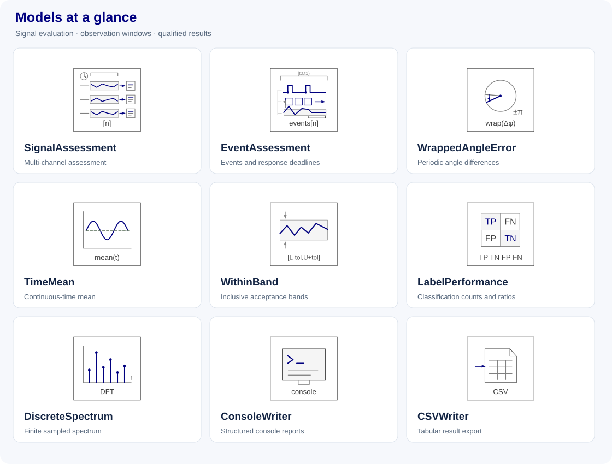

# EvaluationLibrary v1.0.0

English · [简体中文](README.zh-CN.md)

## Overview

EvaluationLibrary is a Modelica library for signal metrics, requirement checks and result reporting. It evaluates simulation signals and events, keeping numerical availability, data quality and requirement verdicts explicit.

**Dependency:** Modelica Standard Library 4.0.0.

## Documentation

- [User Guide](docs/UserGuide.md) — installation, model selection, worked examples and the complete class reference.
- [中文使用手册](docs/UserGuide.zh-CN.md)

## Licence

[GNU General Public License v3](LICENSE).
