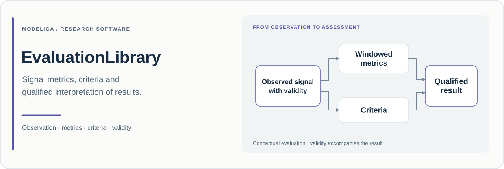

# EvaluationLibrary

**Modelica metrics and requirement assessment with explicit evidence qualification.**

**English** · [简体中文](README_zh.md)

[](package.mo)
[](package.mo)

[Purpose](#purpose) · [Evidence semantics](#evidence-semantics) · [Quick start](#quick-start) · [Examples](#examples) · [Research use](#research-use)

## Purpose

EvaluationLibrary turns observed simulation signals into numerical measures and explicit requirement verdicts. It covers time and sample statistics, transient response, bounds and deadlines, paired comparisons, classification labels and selected frequency-domain measures.

Its central concern is the relationship between a result and the evidence supporting it. A numerical value, a completed observation window, an invalid measurement and a witnessed violation are different facts. The library represents those facts separately so that an attractive curve or an available number is not automatically interpreted as a satisfied requirement.

The blocks read signals from the host model. They can therefore be connected as an observation layer for comparative experiments, response characterisation and simulation-based requirement assessment.

| At a glance | Current source |
| :--- | :--- |
| Modelica package | `EvaluationLibrary` |
| Package version | **0.3.0**, declared in [package.mo](package.mo) |
| Declared library dependency | Modelica Standard Library **4.0.0** |
| Example definitions | **10**, including one with an outstanding packaging dependency described below |
| Reviewed source baseline | [`88ec735`](https://github.com/Ruizhe-Yang/EvaluationLibrary/commit/88ec73514a431f777d761f29b9b970dbf1dee6a7), 12 November 2026 |

## Evidence semantics

The standard evaluators share a typed [`MetricOutput`](Utilities/Interfaces/MetricOutput.mo) containing the numerical value and its availability, data status, verdict, violation witness, first violation time, valid duration, sample counts and finalisation flag. The [`MetricResult`](Utilities/Types/MetricResult.mo) record additionally defines identifiers, units, window metadata and requirement-version fields.

| Question | Source representation |
| :--- | :--- |
| Is a numerical value available? | `valueAvailable` |
| What is the observation's coverage and validity? | `DataStatus`: `PENDING`, `COMPLETE`, `INCOMPLETE`, `INVALID`, `NOT_APPLICABLE` |
| What does the requirement conclude? | `Verdict`: `UNDECIDED`, `SATISFIED`, `VIOLATED`, `INVALID`, `NOT_APPLICABLE` |
| Was a qualified violation observed? | `everViolated` and `firstViolationTime` |
| Has collection been finalised? | `complete`; inspect `dataStatus` separately for coverage |

[`WindowEvidence`](Utilities/Internal/WindowEvidence.mo) supports a fixed half-open interval `[start, stop)` or the first externally supplied window. A subsequent external window is flagged as invalid. Normal simulation termination can finalise an incompletely observed interval: **`complete=true` does not imply `dataStatus=COMPLETE`**.

The [verdict function](Utilities/Functions/ToVerdict.mo) gives invalid data precedence over a requirement verdict while retaining any previously recorded violation witness. An incomplete window without such a witness remains undecided. A fully observed numerical metric is also not automatically a satisfied requirement; a criterion is needed to make that judgement.

## Model organisation

| Package | Available source functionality |
| :--- | :--- |
| [Signals](Signals) | Paired errors, wrapped angular error, finite differences and validity gating |
| [Statistics](Statistics) | Continuous integrals and duration-weighted statistics; statistics on an explicit sample grid |
| [Response](Response) | Rise/fall time, terminal settling, event counts, recovery and request–response timing |
| [Requirements](Requirements) | Bounds, persistence, deadlines and conjunction of qualified results |
| [Comparison](Comparison) | Paired improvement, channel consistency and binary label statistics |
| [Frequency](Frequency) | Finite DFT, selected-frequency amplitude/phase, harmonic distortion and peak decay |
| [Utilities](Utilities) | Evidence qualification, typed connectors, records, numerical and formatting helpers |
| [Examples](Examples) | Connected demonstrations with explicit observation windows |
| [UsersGuide](UsersGuide) | In-tool information pages |

## Current source status

**Packaging gap.** [package.order](package.order) and the [model catalogue](model-catalog.csv) declare a `Results` package, but that directory is absent from the reviewed Git checkout. Consequently, the result-table, aggregate-writer and file-export workflow in [`ResultAggregationAndFiles`](Examples/ResultAggregationAndFiles.mo) has unresolved class dependencies. The catalogue's `Results.*` entries are not presently shipped implementations. Resolve that packaging gap before using that workflow or claiming a successful whole-library check. The table above describes the packages actually present.

## Quick start

```bash
git clone https://github.com/Ruizhe-Yang/EvaluationLibrary.git
cd EvaluationLibrary
```

Load **Modelica 4.0.0** and open the root `package.mo`. Inspect loading and translation diagnostics in view of the packaging note above. For the core metric implementation, start with `EvaluationLibrary.Examples.AnalyticStatistics`, which has no reference to the missing `Results` package. Its experiment is **0–2.1 s**, with tolerance **1e-6**.

If loading reports the absent `Results` entry, restore the missing source package before attempting simulation. The core example below is the intended OpenModelica entry point; it is not a claim that this checkout passes a whole-library load or translation:

```modelica
loadModel(Modelica, {"4.0.0"});
loadFile("package.mo");
getErrorString();
```

Continue only if package loading succeeds (`loadFile` returns `true`):

```modelica
simulate(EvaluationLibrary.Examples.AnalyticStatistics,
  startTime=0, stopTime=2.1, numberOfIntervals=500, tolerance=1e-6);
getErrorString();
```

The input is `u=time`, and the observation window is `[0, 2)`. Analytical reference values are **2** for the integral, **1** for the time mean, **2/√3** for the time RMS and **1/3** for the time variance. The sample grid is `0, 0.01, …, 1.99`: its **200** observations have a sample mean of **0.995**. These reference values follow from the example definition; they are not new execution results. Inspect the matching availability and data-status fields after the window closes.

## Examples

| Example | Research question | Useful outputs | Declared stop |
| :--- | :--- | :--- | ---: |
| [AnalyticStatistics](Examples/AnalyticStatistics.mo) | How do continuous and sampled statistics differ? | `integralValue`, `timeMeanValue`, `sampleMeanValue`, `sampleMean.nValid` | 2.1 s |
| [BoundsAndValidWitness](Examples/BoundsAndValidWitness.mo) | What happens when invalid data follow a valid violation? | Evaluator `dataStatus`, `verdict`, `everViolated`, `firstViolationTime` | 2.1 s |
| [FirstOrderResponse](Examples/FirstOrderResponse.mo) | How are rise and terminal settling times measured? | `riseSeconds`, `settlingSeconds`, `settling.settled` | 4.1 s |
| [RepeatedRequestResponse](Examples/RepeatedRequestResponse.mo) | Which requests match, time out or become censored? | `paired.matched`, `.timedOut`, `.censored`, `.unmatchedResponse` | 4.1 s |
| [PairedPerformance](Examples/PairedPerformance.mo) | How is improvement computed for comparable trajectories? | `absoluteChange`, `relativeChange` | 2.1 s |
| [ConsistencyAndLabels](Examples/ConsistencyAndLabels.mo) | How do numeric consistency and label accuracy differ? | `spread`, `accuracy`, `labels.TP`, `.TN`, `.FP`, `.FN` | 4.1 s |
| [HarmonicMeasurements](Examples/HarmonicMeasurements.mo) | What can a finite coherent sample window reveal? | `spectrum.amplitude`, `fundamentalValue`, `distortion.thd` | 2.1 s |
| [DecayMeasurement](Examples/DecayMeasurement.mo) | How do qualified positive peaks attenuate? | `decay.peakCount`, `decay.ratio`, `decay.logarithmicDecrement` | 3.1 s |
| [IncompleteWindow](Examples/IncompleteWindow.mo) | How does termination before the requested end affect evidence? | `noWitness.dataStatus`, `.verdict`; `withWitness.everViolated` | 1 s |
| [ResultAggregationAndFiles](Examples/ResultAggregationAndFiles.mo) | Intended structured result and writer workflow | **Blocked by the missing `Results` package** | 2.1 s |

## Research use

Choose the observation window and criterion before interpreting a result. Record signal definitions and units, requirement thresholds and versions, validity rules, sampling period, host-model revision, solver settings and the library commit. Preserve both the verdict and its supporting qualification fields.

For comparisons, establish matching units, windows and interpretations. For settling time, [`Response.SettlingTime`](Response/SettlingTime.mo) confirms the final band entry only at the end of a fully observed window with the required dwell. For repeated responses, [`Response.RepeatedResponse`](Response/RepeatedResponse.mo) uses a finite FIFO queue and distinguishes timeouts, unmatched responses and requests censored by the end of observation. These distinctions should remain visible in reported results.

When citing the software, identify **EvaluationLibrary, version 0.3.0**, the repository URL and the commit used. The [change log](CHANGELOG.md) and [commit history](https://github.com/Ruizhe-Yang/EvaluationLibrary/commits/main/) support maintenance and replication.

## Scope and assumptions

Assessment depends on the supplied signals, their validity and the chosen observation conditions. A result does not independently establish the fidelity of the host model or certify a physical system. Frequency analysis depends on the declared finite sampling grid and window; event pairing has explicit queue and record capacities. The current packaging gap limits the documented result-export workflow. Reproduce the selected example and its numerical expectations in the intended Modelica tool before using it in an experiment.

## Licence and contributions

The repository contains the [GNU General Public License, version 3](LICENSE). For an issue or contribution, provide the version or commit, tool version, minimal model, observation-window settings, expected result and actual qualification fields. Evidence semantics, numerical reference cases and package completeness are valuable areas for improvement.
