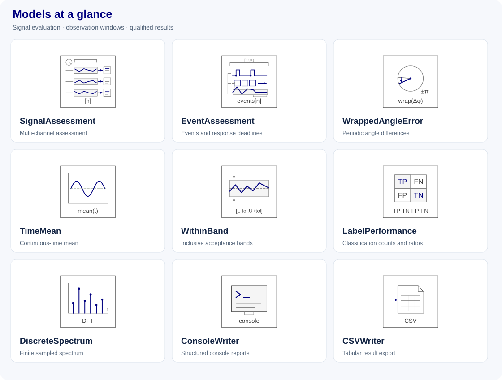

# EvaluationLibrary v1.0.0

[English](README.md) · 简体中文

## 项目概述

EvaluationLibrary 是用于信号指标计算、要求判定与结果报告的 Modelica 库。它观测仿真信号和事件，并分别呈现数值可用性、数据有效性与要求判定。

**依赖：**Modelica Standard Library 4.0.0。

## 使用手册

- [中文使用手册](docs/UserGuide.zh-CN.md)：安装、模型选型、完整练习和全部类的参考说明。
- [User Guide — English](docs/UserGuide.md)

## 许可证

[GNU General Public License v3](LICENSE)。
