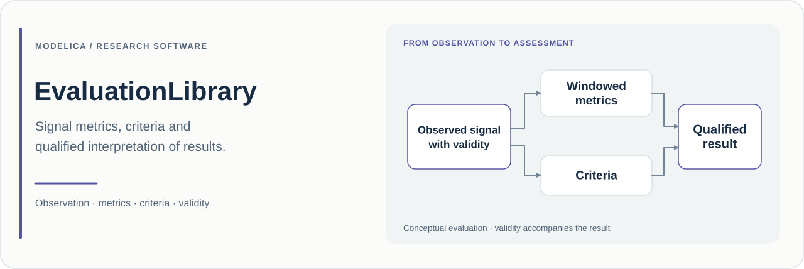

# EvaluationLibrary

**在 Modelica 中计算指标、评价需求，并显式记录证据有效性。**

[English](README.md) · **简体中文**

[](package.mo)
[](package.mo)

## 项目目的

EvaluationLibrary 将观测到的仿真信号转化为数值指标和显式需求判定，覆盖时间与采样统计、瞬态响应、边界与时限、配对比较、分类标签以及部分频域指标。

本库重点表达结果与支持它的证据之间的关系。存在一个数值、完成一个观测窗口、出现无效测量和观察到违规，是不同的信息。本库分别表达这些信息，避免将看起来理想的曲线或可获得的数值直接解释为需求满足。

模块通过读取本体信号工作，可以作为观测层接入比较实验、响应特性分析和基于仿真的需求评价。

| 基本信息 | 当前源码 |
| :--- | :--- |
| Modelica 根包 | `EvaluationLibrary` |
| 包版本 | **0.3.0**，见 [package.mo](package.mo) |
| 声明的库依赖 | Modelica Standard Library **4.0.0** |
| 示例定义 | **10 个**，其中 1 个存在下文说明的打包依赖缺口 |
| 文档核对基线 | [`88ec735`](https://github.com/Ruizhe-Yang/EvaluationLibrary/commit/88ec73514a431f777d761f29b9b970dbf1dee6a7)，2026 年 11 月 12 日 |

## 证据语义

标准评价模块共享带类型的 [`MetricOutput`](Utilities/Interfaces/MetricOutput.mo)，包含数值及可用性、数据状态、需求判定、违规证据、首次违规时刻、有效持续时间、采样数量和结束标志。[`MetricResult`](Utilities/Types/MetricResult.mo) 记录还定义了标识、单位、窗口信息和需求版本字段。

| 要回答的问题 | 源码中的表达 |
| :--- | :--- |
| 数值是否可用？ | `valueAvailable` |
| 观测覆盖度与数据有效性如何？ | `DataStatus`：`PENDING`、`COMPLETE`、`INCOMPLETE`、`INVALID`、`NOT_APPLICABLE` |
| 需求判定是什么？ | `Verdict`：`UNDECIDED`、`SATISFIED`、`VIOLATED`、`INVALID`、`NOT_APPLICABLE` |
| 是否观察到有效的违规证据？ | `everViolated` 和 `firstViolationTime` |
| 采集是否已结束？ | `complete`；覆盖度仍须单独查看 `dataStatus` |

[`WindowEvidence`](Utilities/Internal/WindowEvidence.mo) 支持固定的左闭右开区间 `[start, stop)`，或第一个外部输入窗口；再次出现的外部窗口会被标为无效。仿真正常终止时也会结束尚未完整观测的区间。因此，**`complete=true` 不代表 `dataStatus=COMPLETE`**。

[判定函数](Utilities/Functions/ToVerdict.mo) 在数据无效时优先给出无效判定，同时保留此前记录的违规证据。缺少违规证据的不完整窗口保持未决。即使数值指标已经完整观测，也不会自动成为“需求满足”，仍需要明确的评价判据。

## 模型组织

| 包 | 当前已存在的源码功能 |
| :--- | :--- |
| [Signals](Signals) | 配对误差、环绕角误差、有限差分与有效性门控 |
| [Statistics](Statistics) | 连续积分和时间加权统计，以及显式采样网格上的统计 |
| [Response](Response) | 上升/下降时间、终端稳定时间、事件计数、恢复与请求响应时序 |
| [Requirements](Requirements) | 边界、持续时间、截止时限与带有效性信息的合取判定 |
| [Comparison](Comparison) | 配对改进量、通道一致性与二分类标签统计 |
| [Frequency](Frequency) | 有限 DFT、指定频率幅相、谐波畸变与峰值衰减 |
| [Utilities](Utilities) | 证据资格判断、类型化连接器、记录、数值和格式化辅助函数 |
| [Examples](Examples) | 带有显式观测窗口的连接式示例 |
| [UsersGuide](UsersGuide) | 建模工具内的信息页面 |

## 当前源码状态

**打包缺口。** [package.order](package.order) 与[模型目录](model-catalog.csv)声明了 `Results` 包，但本次核对的 Git 仓库中不存在该目录。因此，[`ResultAggregationAndFiles`](Examples/ResultAggregationAndFiles.mo) 中的结果表、聚合输出和文件导出工作流存在未解析的类依赖。目录中的 `Results.*` 条目目前不能视为已交付实现。使用该工作流或声称整个库检查通过前，需要先解决该打包缺口。上表仅描述仓库中实际存在的包。

## 快速开始

```bash
git clone https://github.com/Ruizhe-Yang/EvaluationLibrary.git
cd EvaluationLibrary
```

加载 **Modelica 4.0.0**，打开根目录 `package.mo`，并结合上述打包说明检查加载和翻译诊断。核心指标可以从 `EvaluationLibrary.Examples.AnalyticStatistics` 入手，该示例未引用缺失的 `Results` 包。其声明仿真范围为 **0–2.1 s**，容差为 **1e-6**。

如果加载时报告缺少 `Results` 条目，应先补齐缺失的源码包再尝试仿真。以下脚本给出核心示例的预定 OpenModelica 入口，不表示当前仓库已经通过整个库的加载或翻译检查：

```modelica
loadModel(Modelica, {"4.0.0"});
loadFile("package.mo");
getErrorString();
```

只有包加载成功（`loadFile` 返回 `true`）后才继续：

```modelica
simulate(EvaluationLibrary.Examples.AnalyticStatistics,
  startTime=0, stopTime=2.1, numberOfIntervals=500, tolerance=1e-6);
getErrorString();
```

输入为 `u=time`，观测窗口为 `[0, 2)`。解析参考值分别为：积分 **2**、时间均值 **1**、时间均方根 **2/√3**、时间方差 **1/3**。采样网格为 `0, 0.01, …, 1.99`，共 **200 个**观测值，采样均值为 **0.995**。这些参考值由示例定义推导而来，不是本次执行结果。窗口关闭后，还应检查对应的数值可用性和数据状态。

## 示例索引

| 示例 | 研究问题 | 主要输出 | 声明终止时间 |
| :--- | :--- | :--- | ---: |
| [AnalyticStatistics](Examples/AnalyticStatistics.mo) | 连续统计与采样统计有何差别？ | `integralValue`、`timeMeanValue`、`sampleMeanValue`、`sampleMean.nValid` | 2.1 s |
| [BoundsAndValidWitness](Examples/BoundsAndValidWitness.mo) | 有效违规证据之后出现无效数据会怎样？ | 各评价器的 `dataStatus`、`verdict`、`everViolated`、`firstViolationTime` | 2.1 s |
| [FirstOrderResponse](Examples/FirstOrderResponse.mo) | 如何计算上升时间与终端稳定时间？ | `riseSeconds`、`settlingSeconds`、`settling.settled` | 4.1 s |
| [RepeatedRequestResponse](Examples/RepeatedRequestResponse.mo) | 哪些请求得到匹配、超时或在观测结束时被删失？ | `paired.matched`、`.timedOut`、`.censored`、`.unmatchedResponse` | 4.1 s |
| [PairedPerformance](Examples/PairedPerformance.mo) | 如何比较具有一致解释的轨迹？ | `absoluteChange`、`relativeChange` | 2.1 s |
| [ConsistencyAndLabels](Examples/ConsistencyAndLabels.mo) | 数值一致性与标签准确率有何差别？ | `spread`、`accuracy`、`labels.TP`、`.TN`、`.FP`、`.FN` | 4.1 s |
| [HarmonicMeasurements](Examples/HarmonicMeasurements.mo) | 有限相干采样窗口可以说明什么？ | `spectrum.amplitude`、`fundamentalValue`、`distortion.thd` | 2.1 s |
| [DecayMeasurement](Examples/DecayMeasurement.mo) | 有效正峰值如何衰减？ | `decay.peakCount`、`decay.ratio`、`decay.logarithmicDecrement` | 3.1 s |
| [IncompleteWindow](Examples/IncompleteWindow.mo) | 在指定终点之前结束仿真如何影响证据？ | `noWitness.dataStatus`、`.verdict`；`withWitness.everViolated` | 1 s |
| [ResultAggregationAndFiles](Examples/ResultAggregationAndFiles.mo) | 计划提供的结构化结果与输出工作流 | **当前受缺失的 `Results` 包阻塞** | 2.1 s |

## 科研使用建议

解释结果之前，应先确定观测窗口和评价判据。记录信号定义及单位、需求阈值与版本、有效性规则、采样周期、本体模型版本、求解设置和本库提交，同时保留判定与支持它的资格字段。

比较实验需要保证单位、窗口和物理含义一致。[`Response.SettlingTime`](Response/SettlingTime.mo) 在完整窗口结束时，结合规定的驻留时间确认最后一次进入误差带的时刻。[`Response.RepeatedResponse`](Response/RepeatedResponse.mo) 使用有限容量的先进先出队列，并区分超时、未匹配响应和因观测结束而删失的请求。报告结果时应保留这些差别。

引用软件时，请注明 **EvaluationLibrary，版本 0.3.0**、仓库地址和使用的提交。[更新记录](CHANGELOG.md)与[提交历史](https://github.com/Ruizhe-Yang/EvaluationLibrary/commits/main/)可支持维护和复现。

## 适用范围与假设

评价依赖于提供的信号、信号有效性和选定观测条件。结果不能独立证明本体模型保真度，也不构成物理系统认证。频域分析受有限采样网格与窗口设置影响；事件配对具有明确的队列和记录容量。当前打包缺口限制了结果导出工作流。用于研究实验前，应在目标 Modelica 工具中复现选定示例及相应数值预期。

## 许可证与贡献

仓库包含 [GNU 通用公共许可证第 3 版](LICENSE)。提交问题或改进时，请提供版本或提交、工具版本、最小模型、窗口设置、预期结果及实际资格字段。证据语义、数值参考案例和包完整性方面的改进有助于后续维护。
