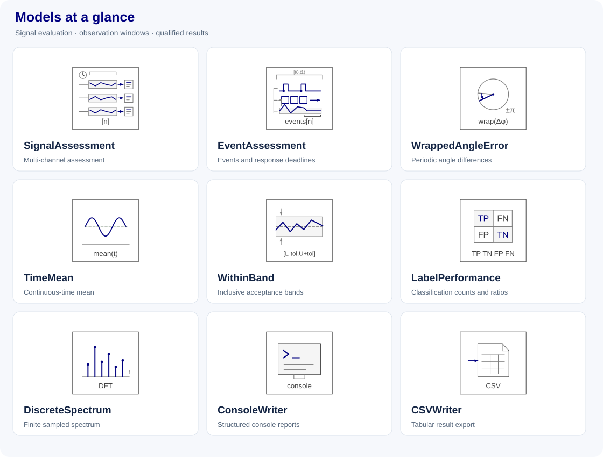

# EvaluationLibrary v1.0.0 — User Guide

English · [简体中文](UserGuide.zh-CN.md) · [Project overview](../README.md)

Installation, modelling exercises, result interpretation and complete class reference for EvaluationLibrary.

## Contents

- [1. Start with the library](#1-start-with-the-library)
- [2. Load and run an example](#2-load-and-run-an-example)
- [3. Build a signal assessment](#3-build-a-signal-assessment)
- [4. Check a response deadline](#4-check-a-response-deadline)
- [5. Choose the right class](#5-choose-the-right-class)
- [6. Interpret qualified results](#6-interpret-qualified-results)
- [7. Write console, CSV and text output](#7-write-console-csv-and-text-output)
- [8. Configure windows and sampling](#8-configure-windows-and-sampling)
- [9. Complete class reference](#9-complete-class-reference)
- [10. Continue with the examples](#10-continue-with-the-examples)
- [11. Troubleshooting and scope](#11-troubleshooting-and-scope)
- [12. Documentation and further reading](#12-documentation-and-further-reading)

## 1. Start with the library

EvaluationLibrary measures simulation signals and events, checks requirements and reports results with explicit data qualification. It contains 75 public evaluation blocks, supporting result interfaces and functions, and nine self-contained examples. The only library dependency is Modelica Standard Library 4.0.0.

This guide follows a practical sequence: run an existing example, assemble a small model, vary its parameters, then interpret the result. The exercises use top-level `within;` clauses; save each in a separate `.mo` file, or adjust `within` when placing it in a named package. The English and Chinese manuals use the same Modelica class names and parameter names.

### Three decisions before connecting a block

- **Quantity:** which signal or event is being observed, and in which unit?
- **Observation:** which window, sample grid and validity condition are appropriate?
- **Interpretation:** is the output a descriptive metric, a requirement decision or a finite-set summary?

## 2. Load and run an example

1. Extract the archive. Keep the `EvaluationLibrary` directory, its `package.mo` and all subdirectories together.
2. Load **Modelica 4.0.0** in your Modelica environment, then open `EvaluationLibrary/package.mo`. Avoid loading a second copy of the same package name.
3. Open `EvaluationLibrary.Examples.MultiSignalAssessment`. Inspect its Diagram view, then use its stored experiment: start 0 s, stop 2.2 s, output interval 0.01 s and tolerance 10⁻⁷.
4. Run the model and read the console summary. In the result browser, inspect `assessment.y`, `assessment.minimum`, `assessment.maximum` and `report.overall`.

| Channel | Input and criterion | Expected interpretation |
| --- | --- | --- |
| angle | Sine amplitude 0.1 rad; absolute value ≤ 0.2 rad | Satisfied |
| position | Ramp to 2 m; absolute value ≤ 1 m | Violated once the ramp exceeds 1 m |
| current | Constant 0.3 A; absolute value ≤ 0.5 A | Satisfied |

The observation ends at 2 s and excludes that endpoint. The simulation runs slightly longer so the closed results can be inspected. The table gives analytical expectations from the source definitions; compare them with your simulator output.

### OpenModelica command-line equivalent

Run these commands from the directory that contains the `EvaluationLibrary` folder. The packaged `Resources/Scripts/export_smoke.mos` follows the same working-directory convention.

```modelica
loadModel(Modelica, {"4.0.0"});
loadFile("EvaluationLibrary/package.mo");
checkModel(EvaluationLibrary.Examples.MultiSignalAssessment);
simulate(EvaluationLibrary.Examples.MultiSignalAssessment,
  startTime=0, stopTime=2.2, numberOfIntervals=220,
  tolerance=1e-7);
getErrorString();
```

Check that the library loads and that the model check succeeds in your chosen Modelica environment before running the examples.

## 3. Build a signal assessment

Create a new model named `FirstAssessment`. Add a sine source, `Statistics.SignalAssessment` and `Results.ConsoleWriter`. In a graphical editor, connect `signal.y` to `assessment.u[1]`, then connect the complete `assessment.y` array to `report.u`. The following complete model provides the same connections.

```modelica
within;
model FirstAssessment "Assess a sine signal against an acceptance band"
  Modelica.Blocks.Sources.Sine signal(amplitude=0.8, f=1);
  EvaluationLibrary.Statistics.SignalAssessment assessment(
    n=1,
    metricId={"signal"},
    unitName={"1"},
    lower={-1},
    upper={1},
    windowStop=2,
    samplePeriod=0.01);
  EvaluationLibrary.Results.ConsoleWriter report(
    n=1, runId="first_assessment");
equation
  connect(signal.y, assessment.u[1]);
  connect(assessment.y, report.u);
  annotation(experiment(StartTime=0, StopTime=2.1,
    Interval=0.01, Tolerance=1e-6));
end FirstAssessment;
```

| Setting | Choice in this exercise | Effect |
| --- | --- | --- |
| `n` | 1 | One interpreted signal and one complete result. |
| `metricId`, `unitName` | `{"signal"}`, `{"1"}` | Identify the result and declare its unit. |
| `lower`, `upper` | −1, +1 | Inclusive acceptance band. |
| `windowStart`, `windowStop` | 0, 2 s | Observe [0, 2) s. |
| `samplePeriod` | 0.01 s | Sample the reported extrema on a 200-point grid. |
| `sampled` | false (default) | Use continuous event relations for bound checks. |

### Inspect, then vary

1. Plot `assessment.evaluated[1]`, `assessment.minimum[1]` and `assessment.maximum[1]`. The expected extrema are −0.8 and +0.8.
2. After collection closes, inspect `assessment.y[1].valueAvailable`, `dataStatus` and `verdict`. With the stated setup, expect complete evidence and a satisfied requirement.
3. Change `signal.amplitude` to 1.2 and rerun. The band is violated; inspect `everViolated`, `firstViolationTime` and `violationDuration[1]`.
4. Set `sampled=true` and compare the result. Only sample ticks determine bound violations in this mode; `violationDurationAvailable` becomes false.

### Add channels or change the interpretation

Set `n` to the number of channels and supply arrays of the same length for identifiers, units and criteria. Each channel can use `SignedValue`, `AbsoluteValue`, `Difference` or `WrappedAngleDifference`. Use the wrapped form only for angle differences in radians. It evaluates `atan2(sin(u-reference), cos(u-reference))`. Unit labels are metadata and do not convert degrees to radians.

## 4. Check a response deadline

The request and response are distinct observations. For a deadline check, connect the request event and the measured action feedback to `Response.EventAssessment`. The default mode is `RequestResponse`.

```modelica
within;
model FirstDeadline "Check the delay between a request and its response"
  Modelica.Blocks.Sources.BooleanStep request(startTime=0.2);
  Modelica.Blocks.Sources.BooleanStep response(startTime=0.3);
  EvaluationLibrary.Response.EventAssessment assessment(
    n=1,
    metricId={"response_delay"},
    deadline={0.2},
    windowStop=1);
  EvaluationLibrary.Results.ConsoleWriter report(
    n=1, runId="first_deadline");
equation
  connect(request.y, assessment.request[1]);
  connect(response.y, assessment.response[1]);
  connect(assessment.y, report.u);
  annotation(experiment(StartTime=0, StopTime=1.1,
    Interval=0.01, Tolerance=1e-6));
end FirstDeadline;
```

The request occurs at 0.2 s and the response at 0.3 s. The expected matched delay is 0.1 s, within the 0.2 s deadline. Inspect `assessment.matched[1]`, `timedOut[1]`, `censored[1]` and `y[1].verdict`. Change the response start to 0.5 s to observe an expired request.

| Mode | Observed inputs | Interpretation |
| --- | --- | --- |
| `Occurrence` | Rising edges at `request`; connect all declared inputs. | Event count; a descriptive metric. |
| `RequestResponse` | Separate request and response rising edges. | First-in, first-out matching with one response per request. |
| `Recovery` | Danger at `request`, recovery-band condition at `response`. | First danger followed by uninterrupted valid recovery dwell. |

- Requests at the same instant are registered before responses, so zero-delay matching is possible. A response exactly at its deadline is accepted inside the observation window.
- The window stop is excluded. An unresolved request whose deadline is at or after the exclusive window stop is censored; increase the observation window when longer follow-up is required.
- An invalid observation gap breaks the event history; queue overflow makes the evidence invalid. Set `capacity` for the expected number of pending requests.
- Before recovery is confirmed, loss of validity, return of danger or departure from the recovery band restarts the dwell interval. The first confirmed recovery is latched. With `useRecoverySignal=true`, configure `recoveryReference`, `recoveryTolerance` and connect `recoverySignal`. The always-declared Boolean inputs still need bindings.

After a complete observation, `EventAssessment` marks a `RequestResponse` or `Recovery` task with no qualified request as `NOT_APPLICABLE`. An `Occurrence` task remains a descriptive event count.

`ResponseDelay`, `ResponseTime` and `ResponseDeadline` expose different specialised definitions. In particular, `ResponseTime` accepts Boolean conditions, and `ResponseDeadline` does not use the same no-demand outcome as `EventAssessment`. Read their individual documentation when selecting them.

## 5. Choose the right class

| Task | Start with | Connection or configuration |
| --- | --- | --- |
| Related numeric signals | `Statistics.SignalAssessment` | Real inputs to `u`; result array `y` to a writer. |
| Related event tasks | `Response.EventAssessment` | Request and response arrays; per-task mode and deadline/dwell. |
| Continuous-time mean or RMS | `Statistics.TimeMean`, `TimeRMS` | Set the actual window parameters and validity input. |
| Sampled moments | `Statistics.SampledMoments` | One sample grid for mean, RMS and population variance. |
| Single requirement | `Requirements.UpperBound`, `WithinBand` | Configure limits; optionally enable `useValidInput` and connect `valid`; inspect verdict and margin separately. |
| Diagnostic labels | `Comparison.LabelPerformance` | Bind observed and reference labels; connect the eight-result `y` array. |
| Finite sampled spectrum | `Frequency.DiscreteSpectrum` | Match `nSamples` to the window and sample grid. |
| Final report | `Results.ConsoleWriter` | Connect complete results; set `n` and optional `required`. |

### Library structure

| Package | Scope |
| --- | --- |
| [Signals](../Signals/package.mo) | Differences, relative errors, angle wrapping, finite differences and validity gates. |
| [Statistics](../Statistics/package.mo) | Continuous and sampled statistics, shared multi-channel assessment and accumulated quantities. |
| [Response](../Response/package.mo) | Event counts, request–response matching, recovery, dwell and transient response measures. |
| [Requirements](../Requirements/package.mo) | Numeric and Boolean conditions, bands, persistence, deadlines and resource margins. |
| [Comparison](../Comparison/package.mo) | Paired signals, channel consistency, finite-run summaries and classification performance. |
| [Frequency](../Frequency/package.mo) | Finite sampled spectra, single tones, harmonic distortion, gain/phase and decay ratios. |
| [Results](../Results/package.mo) | Aggregate qualified results, calculate scores and write console, CSV or text output. |
| [Utilities](../Utilities/package.mo) | Result connectors, records, enumerations, formatting functions and internal observation helpers. |
| [Examples](../Examples/package.mo) | Nine small, self-contained examples of the public API. |
| [UsersGuide](../UsersGuide/package.mo) | Overview, getting started, conventions and limitations inside the modelling tool. |



Original model icons, exported from their Modelica graphics.

The [complete class reference](#9-complete-class-reference) contains every class, including packages, example models, types, functions and internal helpers. Internal helpers support the public blocks and are not the normal entry point for model assembly.

## 6. Interpret qualified results

`MetricOutput` connects directly to `MetricInput`; both carry 30 fixed result and evidence fields. `MetricResult` represents the same information as a record. Configure `metricId`, `unitName` and any requirement metadata at the producer, and match the result-array size to the receiving block’s `n`.

A result separates four questions: is a number available, was the observation complete and valid, has the requirement been decided, and has collection closed? Read the corresponding fields independently.

| Field | Read it as |
| --- | --- |
| `valueAvailable` | Whether `value` has a meaningful numerical interpretation. |
| `dataStatus` | Coverage and validity of the observation. |
| `verdict` | Requirement decision; descriptive statistics can remain undecided. |
| `complete` | Collection is closed; this does not imply complete evidence or a satisfied requirement. |
| `everViolated` | A qualified violation witness has been recorded. |
| `eventCountsAvailable`, `levelAvailable` | Whether the event counters or optional engineering category may be interpreted. |

### Numerical values and observation metadata

| Fields | Interpretation |
| --- | --- |
| `metricId`, `requirementId`, `requirementVersion` | Stable identities and optional requirement metadata supplied by the producer. |
| `value`, `valueAvailable`, `unit` | Numerical result, its availability and its stated unit. Unit labels do not convert values. |
| `windowStart`, `windowStop`, `observedDuration`, `validDuration` | Observation extent and the duration available to the producer. |
| `samplePeriod`, `expectedSamples`, `receivedSamples`, `validSamples` | Sample-grid definition and coverage for sampled evidence. |
| `everViolated`, `firstViolationTime` | A retained violation witness; interpret the instant only when the flag is true. |
| `eventCountsAvailable`, `eventCount`, `matchedCount`, `timedOutCount`, `censoredCount` | Event counters supplied by producers that support them. |
| `levelAvailable`, `level`, `level0Upper`, `level1Upper` | Optional engineering category and its configured thresholds. |
| `evidenceKind`, `message` | Evidence interpretation and a readable explanation. |

### Status codes in connectors

`MetricInput` and `MetricOutput` carry integer enumeration codes. `MetricResult` uses the enumeration types. The code order is not the aggregation priority.

| Code | DataStatus | Verdict |
| --- | --- | --- |
| 1 | PENDING | UNDECIDED |
| 2 | COMPLETE | SATISFIED |
| 3 | INCOMPLETE | VIOLATED |
| 4 | INVALID | INVALID |
| 5 | NOT_APPLICABLE | NOT_APPLICABLE |

A result can be `COMPLETE / UNDECIDED` when it is a statistic with no requirement. An unavailable number is not zero evidence. A closed collection can be incomplete when the requested observation could not be finished.

### Aggregate only the intended requirements

`VerdictAggregator` and the writers use `required` to select entries for the overall decision; individual entries remain visible. Non-applicable entries are excluded. Among included entries, invalid data dominates a violation, which dominates an undecided result. All included entries must be satisfied to obtain `SATISFIED`; no included entries gives `NOT_APPLICABLE`.

If a descriptive statistic is included as required, its undecided verdict can keep the overall result undecided. Set the corresponding `required[i]` entry to false when it should be reported without contributing a requirement decision.

## 7. Write console, CSV and text output

All writers accept complete results through `u[n]`. Configure metadata at the producing block, then connect the whole result or result array. A scalar producer uses `connect(metric.result, writer.u[1])`. Collection is written once when every result has closed, or at normal simulation termination.

```modelica
EvaluationLibrary.Results.CSVWriter csv(
  n=1,
  runId="trial",
  resultSetId="signals",
  outputDirectory=".");
// Add to the equation section:
connect(assessment.y, csv.u);
```

This declaration and connection belong inside an existing model, such as `FirstAssessment`; they are not a complete standalone model. The destination is `trial_signals.csv` in the simulator working directory.

| Writer | Output | What to inspect |
| --- | --- | --- |
| `ConsoleWriter` | Console summary in declaration order | `overall`, `written` |
| `CSVWriter` | Header and rows with `runId` plus all 30 result fields | `filePath`, `written`, `skippedExisting` |
| `TextWriter` | One formatted line per result | `filePath`, `written`, `skippedExisting` |

- Create the destination directory before simulating. Relative paths are resolved by the simulator working directory.
- The default `WritePolicy.RejectExisting` preserves an existing file and sets `skippedExisting`. Select `WritePolicy.Overwrite` only when you intend to replace that file.
- Use different `runId`, `resultSetId` or `filePath` values when retaining multiple runs.
- Unavailable values are formatted as `N/A` where appropriate. Export success is independent of the requirement verdict. A file-system error can stop a simulation through the Modelica Standard Library file functions.

## 8. Configure windows and sampling

### Use the parameters of the selected class

| Interface pattern | Typical parameters | Validity |
| --- | --- | --- |
| Shared assessment blocks | `windowStart`, `windowStop`; signal sampling uses `sampleStart` | Optional `valid` via `useValidInput` |
| Window-configurable individual blocks | `windowMode`, `windowStart`, `windowStop` | Optional validity; `ExternalSingle` exposes a window input |
| Fixed-window specialised blocks | `windowStart`, `windowEnd`; sampled classes may expose `sampleOffset` | A declared `valid` input must be bound |

The windows are half open. A tick exactly at the start is included; a tick exactly at the stop is excluded. Blocks with `ExternalSingle` accept the first contiguous external window. A later reopening invalidates that observation. Sample-grid origins and external window boundaries are independent settings.

### Match frequency buffers to the sample grid

For `SingleFrequency`, `DiscreteSpectrum` and `HarmonicDistortion`, explicitly configure the finite sample count. For a zero-based grid, `nSamples=200`, `samplePeriod=0.01` and `windowStop=2` give 200 samples in [0, 2) s. Their default combination with `windowStop=5` would provide 500 ticks and exceed a 200-sample buffer. Do not leave that combination unadjusted.

```modelica
EvaluationLibrary.Frequency.SingleFrequency tone(
  frequency=2,
  nSamples=100,
  samplePeriod=0.01,
  sampleStart=0,
  windowStart=0,
  windowStop=1,
  metricId="tone_amplitude",
  unitName="V");
```

This is the configuration used by the small frequency example. It estimates a finite-window tone; the result depends on the sample grid, window function and coherence with the tone. The simulator output interval is not the evaluator sample period.

### Read validity rules locally

Different helpers observe validity differently: `WindowEvidence` latches invalid input during the active window, whereas `SampledEvidence` checks scheduled ticks. Public blocks can add their own finite-value and denominator checks. Their `dataStatus` and availability fields are the authoritative qualification for that producer.

## 9. Complete class reference

The following tables cover all **147 Modelica classes**, including the 75 public evaluation blocks, packages, example models, result types, functions and internal helpers. Each class name links to its source file. Read the class documentation in your modelling environment for its exact inputs, parameters and numerical definition.

### 9.1 Library

| Class | Kind | Purpose |
| --- | --- | --- |
| [`EvaluationLibrary`](../package.mo) | Package | Signal metrics, requirement checks and qualified result reporting |

### 9.2 Signals

| Class | Kind | Purpose |
| --- | --- | --- |
| [`AbsoluteError`](../Signals/AbsoluteError.mo) | Block | Absolute difference between two signals |
| [`Difference`](../Signals/Difference.mo) | Block | Signed difference between two signals |
| [`FiniteDifference`](../Signals/FiniteDifference.mo) | Block | Backward difference of consecutive valid samples |
| [`RelativeError`](../Signals/RelativeError.mo) | Block | Signed relative error with a reference magnitude limit |
| [`ValidityGate`](../Signals/ValidityGate.mo) | Block | Signal pass-through with range and age qualification |
| [`WrappedAngleError`](../Signals/WrappedAngleError.mo) | Block | Signed angular error wrapped to one revolution |
| [`EvaluationLibrary.Signals`](../Signals/package.mo) | Package | Signal transformations and data validity |

### 9.3 Statistics

| Class | Kind | Purpose |
| --- | --- | --- |
| [`ControlEffort`](../Statistics/ControlEffort.mo) | Block | Integrated normalised actuator effort and rated-load duration |
| [`EnergyEfficiency`](../Statistics/EnergyEfficiency.mo) | Block | Energy efficiency over an observation interval |
| [`GatedPeak`](../Statistics/GatedPeak.mo) | Block | Sampled peak severity during a hazard condition |
| [`Integral`](../Statistics/Integral.mo) | Block | Signed integral over an observation interval |
| [`LinearTrend`](../Statistics/LinearTrend.mo) | Block | Least-squares linear trend of uniformly sampled values |
| [`SampleExtrema`](../Statistics/SampleExtrema.mo) | Block | Sampled extrema, occurrence times and peak-to-peak range |
| [`SampleMean`](../Statistics/SampleMean.mo) | Block | Arithmetic mean of uniformly sampled values |
| [`SampleRMS`](../Statistics/SampleRMS.mo) | Block | Root mean square of uniformly sampled values |
| [`SampleVariance`](../Statistics/SampleVariance.mo) | Block | Sample variance with a configurable degrees-of-freedom correction |
| [`SampledMoments`](../Statistics/SampledMoments.mo) | Block | One-pass sampled mean, population variance and RMS |
| [`SignalAssessment`](../Statistics/SignalAssessment.mo) | Block | Multi-channel bounds assessment with shared sampling |
| [`TimeMean`](../Statistics/TimeMean.mo) | Block | Time-weighted mean of a continuous signal |
| [`TimeRMS`](../Statistics/TimeRMS.mo) | Block | Time-weighted root mean square of a continuous signal |
| [`TimeVariance`](../Statistics/TimeVariance.mo) | Block | Time-weighted population variance of a continuous signal |
| [`TotalVariation`](../Statistics/TotalVariation.mo) | Block | Sum of absolute changes between consecutive samples |
| [`ZeroCrossingOscillation`](../Statistics/ZeroCrossingOscillation.mo) | Block | Mean period between observed upward level crossings |
| [`EvaluationLibrary.Statistics`](../Statistics/package.mo) | Package | Continuous and sampled signal statistics |

### 9.4 Response

| Class | Kind | Purpose |
| --- | --- | --- |
| [`ConditionOccupancy`](../Response/ConditionOccupancy.mo) | Block | Measure condition duration and occupancy fraction |
| [`EventAssessment`](../Response/EventAssessment.mo) | Block | Assess multiple event tasks in a shared observation window |
| [`EventIntervals`](../Response/EventIntervals.mo) | Block | Measure intervals between successive event rising edges |
| [`FallTime`](../Response/FallTime.mo) | Block | Measure the 10% to 90% progress time of a falling step |
| [`FirstOccurrence`](../Response/FirstOccurrence.mo) | Block | Record the first valid true condition in a window |
| [`MovingAverage`](../Response/MovingAverage.mo) | Block | Compute a continuous mean over a trailing window |
| [`OccurrenceCount`](../Response/OccurrenceCount.mo) | Block | Count valid rising events within an observation window |
| [`OvershootUndershoot`](../Response/OvershootUndershoot.mo) | Block | Measure sampled overshoot and undershoot of a transition |
| [`RecoveryTime`](../Response/RecoveryTime.mo) | Block | Measure recovery delay after a sustained valid return |
| [`RepeatedResponse`](../Response/RepeatedResponse.mo) | Block | Measure repeated request-response delays using a bounded FIFO |
| [`ResponseDelay`](../Response/ResponseDelay.mo) | Block | Measure the delay between the first request and response edges |
| [`RiseFallTime`](../Response/RiseFallTime.mo) | Block | Measure the elapsed time between two directed level crossings |
| [`RiseTime`](../Response/RiseTime.mo) | Block | Measure the 10% to 90% progress time of a rising step |
| [`SampleHistory`](../Response/SampleHistory.mo) | Block | Store a bounded sequence of samples and scheduled times |
| [`SettlingTime`](../Response/SettlingTime.mo) | Block | Confirm the final sustained entry into an error band |
| [`SteadyStateError`](../Response/SteadyStateError.mo) | Block | Evaluate sampled error bias and residual spread |
| [`TrackingError`](../Response/TrackingError.mo) | Block | Compute continuous integral and RMS tracking errors |
| [`ViolationDuration`](../Response/ViolationDuration.mo) | Block | Measure total and longest continuous true durations |
| [`EvaluationLibrary.Response`](../Response/package.mo) | Package | Event timing, response measurements and duration statistics |

### 9.5 Requirements

| Class | Kind | Purpose |
| --- | --- | --- |
| [`BooleanRequirement`](../Requirements/BooleanRequirement.mo) | Block | Check a Boolean condition throughout an observation window |
| [`CircularErrorBound`](../Requirements/CircularErrorBound.mo) | Block | Check an inclusive bound on a wrapped angular error |
| [`LabelEpisodeDelay`](../Requirements/LabelEpisodeDelay.mo) | Block | Measure detection latency within the first labelled episode |
| [`LowerBound`](../Requirements/LowerBound.mo) | Block | Check an inclusive lower bound |
| [`NumericRequirement`](../Requirements/NumericRequirement.mo) | Block | Apply numerical acceptance bounds to an existing metric |
| [`ObjectiveCompletion`](../Requirements/ObjectiveCompletion.mo) | Block | Check objective completion with a failure veto |
| [`PersistenceLimit`](../Requirements/PersistenceLimit.mo) | Block | Limit the duration of each continuous true interval |
| [`ResponseDeadline`](../Requirements/ResponseDeadline.mo) | Block | Check repeated request-response deadlines using FIFO pairing |
| [`ResponseTime`](../Requirements/ResponseTime.mo) | Block | Check the response latency after the first request |
| [`SignedMargin`](../Requirements/SignedMargin.mo) | Block | Compute a normalised resource margin and accumulated deficit |
| [`UpperBound`](../Requirements/UpperBound.mo) | Block | Check an inclusive upper bound |
| [`VectorBounds`](../Requirements/VectorBounds.mo) | Block | Check independent numerical bounds for multiple channels |
| [`WithinBand`](../Requirements/WithinBand.mo) | Block | Check an inclusive interval |
| [`EvaluationLibrary.Requirements`](../Requirements/package.mo) | Package | Numerical, logical and timing requirements |

### 9.6 Comparison

| Class | Kind | Purpose |
| --- | --- | --- |
| [`ChannelConsistency`](../Comparison/ChannelConsistency.mo) | Block | Instantaneous range of valid simultaneous channels |
| [`Improvement`](../Comparison/Improvement.mo) | Block | Absolute and relative improvement between paired results |
| [`LabelPerformance`](../Comparison/LabelPerformance.mo) | Block | Sampled binary classification counts and performance ratios |
| [`MultiRunSummary`](../Comparison/MultiRunSummary.mo) | Block | Summary of a configured set of comparable result values |
| [`PairedArrivalSkew`](../Comparison/PairedArrivalSkew.mo) | Block | Time difference between two first observed arrivals |
| [`PairedDifference`](../Comparison/PairedDifference.mo) | Block | Signed difference between comparable completed results |
| [`SampleCorrelation`](../Comparison/SampleCorrelation.mo) | Block | Pearson correlation of paired uniform samples |
| [`EvaluationLibrary.Comparison`](../Comparison/package.mo) | Package | Comparison of signals, event times and result sets |

### 9.7 Frequency

| Class | Kind | Purpose |
| --- | --- | --- |
| [`DecayRatio`](../Frequency/DecayRatio.mo) | Block | Mean decay ratio of sampled positive peaks |
| [`DiscreteSpectrum`](../Frequency/DiscreteSpectrum.mo) | Block | Single-sided discrete Fourier amplitude spectrum |
| [`HarmonicDistortion`](../Frequency/HarmonicDistortion.mo) | Block | Total harmonic distortion over selected harmonics |
| [`SingleFrequency`](../Frequency/SingleFrequency.mo) | Block | Amplitude and phase at a selected frequency |
| [`ToneResponse`](../Frequency/ToneResponse.mo) | Block | Finite-record input-output gain and phase difference |
| [`EvaluationLibrary.Frequency`](../Frequency/package.mo) | Package | Finite-record frequency and oscillation analysis |

### 9.8 Results

| Class | Kind | Purpose |
| --- | --- | --- |
| [`CSVWriter`](../Results/CSVWriter.mo) | Block | Write connected result records to a CSV file |
| [`ConsoleWriter`](../Results/ConsoleWriter.mo) | Block | Print one summary of connected result records |
| [`EvidenceMonitor`](../Results/EvidenceMonitor.mo) | Block | Observation coverage and data-validity monitor |
| [`GradeByThresholds`](../Results/GradeByThresholds.mo) | Block | Engineering grade from a normalised score |
| [`MinimumMargin`](../Results/MinimumMargin.mo) | Block | Minimum signed margin across a finite set |
| [`SatisfactionFraction`](../Results/SatisfactionFraction.mo) | Block | Fraction of satisfied verdicts in a finite set |
| [`TextWriter`](../Results/TextWriter.mo) | Block | Write connected result records to a text file |
| [`VerdictAggregator`](../Results/VerdictAggregator.mo) | Block | Conjunction of required verdicts with retained result records |
| [`WeightedScore`](../Results/WeightedScore.mo) | Block | Weighted mean of normalised scores |
| [`WorstCase`](../Results/WorstCase.mo) | Block | Value with the greatest absolute magnitude in a finite set |
| [`EvaluationLibrary.Results`](../Results/package.mo) | Package | Result aggregation, qualification and reporting |

### 9.9 Utilities

Use the public evaluation blocks for normal model assembly. The `Internal` classes support their implementation.

| Class | Kind | Purpose |
| --- | --- | --- |
| [`Functions.Aggregate`](../Utilities/Functions/Aggregate.mo) | Function | Combine required verdicts with an explicit priority |
| [`Functions.EvidenceMessage`](../Utilities/Functions/EvidenceMessage.mo) | Function | Describe result availability and qualification |
| [`Functions.FormatRow`](../Utilities/Functions/FormatRow.mo) | Function | Format a result as a CSV record or concise text |
| [`Functions.FormatSummary`](../Utilities/Functions/FormatSummary.mo) | Function | Format a result set and its overall verdict |
| [`Functions.QualifiedCode`](../Utilities/Functions/QualifiedCode.mo) | Function | Qualify a verdict using its data status |
| [`Functions.QuoteCSV`](../Utilities/Functions/QuoteCSV.mo) | Function | Quote and escape a CSV field |
| [`Functions.SafeIdentifier`](../Utilities/Functions/SafeIdentifier.mo) | Function | Check a filename-safe identifier |
| [`Functions.SampleCount`](../Utilities/Functions/SampleCount.mo) | Function | Count uniform samples in a half-open interval |
| [`Functions.StatusFromCode`](../Utilities/Functions/StatusFromCode.mo) | Function | Convert an integer code to a data status |
| [`Functions.StatusText`](../Utilities/Functions/StatusText.mo) | Function | Return the text label of a data status |
| [`Functions.ToVerdict`](../Utilities/Functions/ToVerdict.mo) | Function | Derive a verdict from data status and a violation flag |
| [`Functions.Tone`](../Utilities/Functions/Tone.mo) | Function | Project uniformly spaced samples onto a sinusoid |
| [`Functions.VerdictFromCode`](../Utilities/Functions/VerdictFromCode.mo) | Function | Convert an integer code to a verdict |
| [`Functions.VerdictText`](../Utilities/Functions/VerdictText.mo) | Function | Return the text label of a verdict |
| [`Functions`](../Utilities/Functions/package.mo) | Package | Functions for result qualification, formatting and spectral analysis |
| [`Interfaces.MetricInput`](../Utilities/Interfaces/MetricInput.mo) | Connector | Input connector for a structured evaluation result |
| [`Interfaces.MetricOutput`](../Utilities/Interfaces/MetricOutput.mo) | Connector | Output connector for a structured evaluation result |
| [`Interfaces`](../Utilities/Interfaces/package.mo) | Package | Directional connectors for structured evaluation results |
| [`Internal.AdvanceFIFO`](../Utilities/Internal/AdvanceFIFO.mo) | Internal helper | Update a bounded request-response queue |
| [`Internal.ContinuousAccumulator`](../Utilities/Internal/ContinuousAccumulator.mo) | Internal helper | Integrate a signal and its squared value while enabled |
| [`Internal.ContinuousEvidence`](../Utilities/Internal/ContinuousEvidence.mo) | Internal helper | Track a fixed continuous observation window |
| [`Internal.LogCompletion`](../Utilities/Internal/LogCompletion.mo) | Internal helper | Print the outcome of a completed output operation |
| [`Internal.SampleAccumulator`](../Utilities/Internal/SampleAccumulator.mo) | Internal helper | Accumulate sample moments and extrema |
| [`Internal.SampledEvidence`](../Utilities/Internal/SampledEvidence.mo) | Internal helper | Track validity and coverage on a uniform sample grid |
| [`Internal.SpectrumBuffer`](../Utilities/Internal/SpectrumBuffer.mo) | Internal helper | Store a bounded sequence of samples |
| [`Internal.ToneSpectrum`](../Utilities/Internal/ToneSpectrum.mo) | Internal helper | Calculate a finite one-sided amplitude and phase spectrum |
| [`Internal.WindowEvidence`](../Utilities/Internal/WindowEvidence.mo) | Internal helper | Track one observation window and its data coverage |
| [`Internal.WriteRows`](../Utilities/Internal/WriteRows.mo) | Internal helper | Write a result set to a file or the console |
| [`Internal.csvQuote`](../Utilities/Internal/csvQuote.mo) | Internal helper | Quote and escape an internal CSV field |
| [`Internal.oneSidedDFT`](../Utilities/Internal/oneSidedDFT.mo) | Internal helper | Calculate non-negative discrete Fourier transform bins |
| [`Internal`](../Utilities/Internal/package.mo) | Internal helper | Internal accumulation, observation and output helpers |
| [`Types.AssessmentDirection`](../Utilities/Types/AssessmentDirection.mo) | Type | Direction of inclusive numerical acceptance bounds |
| [`Types.DataStatus`](../Utilities/Types/DataStatus.mo) | Type | Observation coverage and data-validity status |
| [`Types.EventMode`](../Utilities/Types/EventMode.mo) | Type | Event-assessment task |
| [`Types.EventRole`](../Utilities/Types/EventRole.mo) | Type | Descriptive role of an observed event |
| [`Types.EvidenceKind`](../Utilities/Types/EvidenceKind.mo) | Type | Basis of an evaluation result |
| [`Types.Grade`](../Utilities/Types/Grade.mo) | Type | Engineering grade assigned to a qualified score |
| [`Types.InputInterpretation`](../Utilities/Types/InputInterpretation.mo) | Type | Interpretation of a real signal before assessment |
| [`Types.MetricResult`](../Utilities/Types/MetricResult.mo) | Record | Structured metric result with qualification and observation metadata |
| [`Types.NumericComparison`](../Utilities/Types/NumericComparison.mo) | Type | Comparison used to interpret a numerical requirement |
| [`Types.ReportFormat`](../Utilities/Types/ReportFormat.mo) | Type | Format of a result report |
| [`Types.Sense`](../Utilities/Types/Sense.mo) | Type | Direction of improved numerical performance |
| [`Types.SpectralWindow`](../Utilities/Types/SpectralWindow.mo) | Type | Weighting for a finite discrete Fourier transform |
| [`Types.Taper`](../Utilities/Types/Taper.mo) | Type | Weighting for a finite sinusoidal projection |
| [`Types.Verdict`](../Utilities/Types/Verdict.mo) | Type | Requirement outcome independent of observation coverage |
| [`Types.WindowMode`](../Utilities/Types/WindowMode.mo) | Type | Fixed or single externally gated observation window |
| [`Types.WritePolicy`](../Utilities/Types/WritePolicy.mo) | Type | Policy for an existing output file |
| [`Types`](../Utilities/Types/package.mo) | Package | Result record and enumeration types |
| [`EvaluationLibrary.Utilities`](../Utilities/package.mo) | Package | Result types, connectors and shared evaluation functions |

### 9.10 Examples

| Class | Kind | Purpose |
| --- | --- | --- |
| [`ContinuousAndSampleStatistics`](../Examples/ContinuousAndSampleStatistics.mo) | Model | Compare continuous and uniformly sampled statistics |
| [`DiagnosticLabelPerformance`](../Examples/DiagnosticLabelPerformance.mo) | Model | Evaluate Boolean diagnostic decisions against reference labels |
| [`FrequencyOrFileOutput`](../Examples/FrequencyOrFileOutput.mo) | Model | Estimate a sinusoidal amplitude and write its result |
| [`MultiResultSummary`](../Examples/MultiResultSummary.mo) | Model | Combine required verdicts while retaining individual results |
| [`MultiSignalAssessment`](../Examples/MultiSignalAssessment.mo) | Model | Assess three numerical signals in a shared window |
| [`RecoveryAndDwell`](../Examples/RecoveryAndDwell.mo) | Model | Compare successful and unsuccessful recovery |
| [`RepeatedEventMatching`](../Examples/RepeatedEventMatching.mo) | Model | Match repeated request and response edges in FIFO order |
| [`RequestResponseDeadline`](../Examples/RequestResponseDeadline.mo) | Model | Compare timely, late, missing and undemanded responses |
| [`WrappedAngleAndSeverity`](../Examples/WrappedAngleAndSeverity.mo) | Model | Evaluate wrapped angular errors and configured severity levels |
| [`EvaluationLibrary.Examples`](../Examples/package.mo) | Package | Runnable examples of evaluation and result reporting |

### 9.11 UsersGuide

| Class | Kind | Purpose |
| --- | --- | --- |
| [`Conventions`](../UsersGuide/Conventions.mo) | Class | Units, observation windows and result interpretation |
| [`GettingStarted`](../UsersGuide/GettingStarted.mo) | Class | Load the library and run a first assessment |
| [`Limitations`](../UsersGuide/Limitations.mo) | Class | Observation and numerical limits |
| [`Overview`](../UsersGuide/Overview.mo) | Class | Library scope and model groups |
| [`EvaluationLibrary.UsersGuide`](../UsersGuide/package.mo) | Package | User guide |

## 10. Continue with the examples

The example models are small entry points. Each includes its sources, evaluation and reporting, so no external input connections are needed. Run the stored experiment and inspect the quantities named in the model documentation.

| Example | Focus |
| --- | --- |
| [`ContinuousAndSampleStatistics`](../Examples/ContinuousAndSampleStatistics.mo) | Compare continuous and uniformly sampled statistics |
| [`DiagnosticLabelPerformance`](../Examples/DiagnosticLabelPerformance.mo) | Evaluate Boolean diagnostic decisions against reference labels |
| [`FrequencyOrFileOutput`](../Examples/FrequencyOrFileOutput.mo) | Estimate a sinusoidal amplitude and write its result |
| [`MultiResultSummary`](../Examples/MultiResultSummary.mo) | Combine required verdicts while retaining individual results |
| [`MultiSignalAssessment`](../Examples/MultiSignalAssessment.mo) | Assess three numerical signals in a shared window |
| [`RecoveryAndDwell`](../Examples/RecoveryAndDwell.mo) | Compare successful and unsuccessful recovery |
| [`RepeatedEventMatching`](../Examples/RepeatedEventMatching.mo) | Match repeated request and response edges in FIFO order |
| [`RequestResponseDeadline`](../Examples/RequestResponseDeadline.mo) | Compare timely, late, missing and undemanded responses |
| [`WrappedAngleAndSeverity`](../Examples/WrappedAngleAndSeverity.mo) | Evaluate wrapped angular errors and configured severity levels |

`FrequencyOrFileOutput` includes an active CSV writer. It attempts to write `frequency_tone.csv` in the simulator working directory and preserves an existing file by default.

## 11. Troubleshooting and scope

| Symptom | Check |
| --- | --- |
| A model reports an unbound Boolean input. | Some classes require `valid` explicitly. Connect a Boolean validity source; use a constant true only when that assumption is appropriate. Bind all always-declared event inputs. |
| A complete statistic has an undecided verdict. | It may have no requirement. Use a requirement block or the assessment criteria when a pass/fail decision is needed. |
| Results stay pending or become incomplete. | Check window parameters, simulation stop time, sample count, unresolved requests and censored follow-up. |
| A spectrum is invalid with default parameters. | Match `nSamples` and the exact number of ticks inside the half-open window. |
| No new CSV file appears. | Inspect `filePath`, the simulator working directory, directory existence and `skippedExisting`. |
| An instantaneous comparison is unavailable after the window. | `ChannelConsistency` reports the current range and does not retain the maximum range. Select a separate statistic if a final retained measure is required. |
| An improvement result has an unexpected sign. | `Improvement.result` is the inherited candidate-minus-reference value. Direction-adjusted outputs are `absoluteImprovement` and `relativeImprovement`. |
| A summary is complete although some runs were excluded. | `MultiRunSummary` summarises accepted inputs. Compare `nValid` with `nInputs`. |

- Finite samples do not prove strict continuous extrema. Finite candidate sets do not establish a continuous-domain global optimum or an occurrence probability.
- The optional levels 0, 1 and 2 in `SignalAssessment` use sampled absolute interpreted peaks and configured thresholds. They are engineering categories. `GradeByThresholds` exposes its separate A/B/C/D grade through `grade`.
- `SampleHistory` compacts accepted values after invalid ticks while `stamps` describes the planned grid. Do not pair those arrays as valid observations when the history is invalid.
- Numerical behaviour depends on the chosen solver, event handling, sample grid and input model. Recheck example outputs when moving to a different Modelica environment.

## 12. Documentation and further reading

Use the [README](../README.md) for a project overview, the in-tool `UsersGuide` for a short introduction, and each class’s `Documentation` for its precise behaviour. The following resources provide additional Modelica guidance.

- [README — English](../README.md) / [中文说明](../README.zh-CN.md)
- [EvaluationLibrary.UsersGuide](../UsersGuide/package.mo)
- [Buildings Library User Guide — Getting Started](https://simulationresearch.lbl.gov/modelica/userGuide/gettingStarted.html)
- [Buildings — SimpleHouse step-by-step tutorial](https://simulationresearch.lbl.gov/modelica/releases/v11.1.2/help/Buildings_Examples_Tutorial_SimpleHouse.html)
- [Modelica — Documentation conventions](https://doc.modelica.org/Modelica%204.0.0/Resources/helpDymola/Modelica_UsersGuide_Conventions_Documentation.html)
- [Licence: GNU General Public License v3](../LICENSE)
