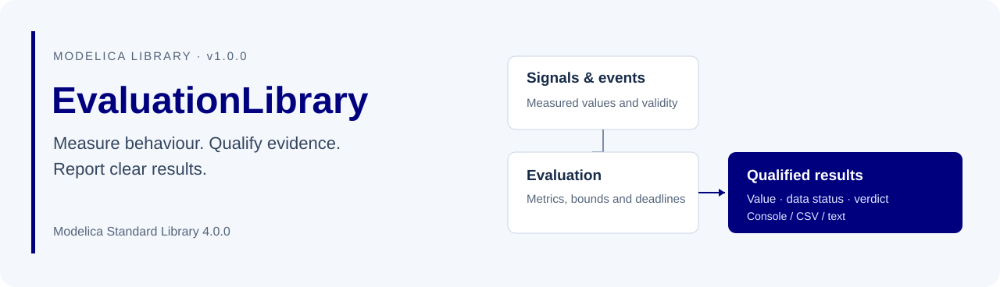
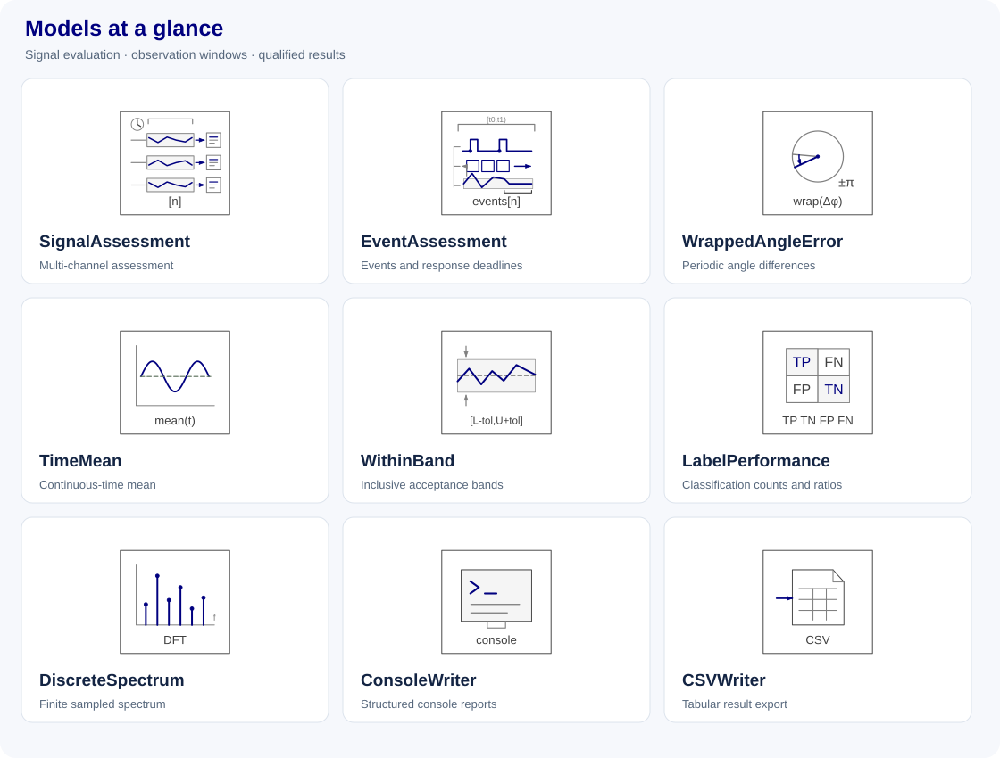

# EvaluationLibrary v1.0.0 使用手册

[English](UserGuide.md) · 简体中文 · [项目说明](../README.zh-CN.md)

本手册介绍库的加载、模型组合、参数配置、结果解释和类目录。Modelica 类与参数名称保留英文，代码可直接复制到相应的 Modelica 环境中使用。

## 目录

- [1. 从库开始](#1-从库开始)
- [2. 加载并运行示例](#2-加载并运行示例)
- [3. 建立信号评价模型](#3-建立信号评价模型)
- [4. 检查响应期限](#4-检查响应期限)
- [5. 选择合适的模型](#5-选择合适的模型)
- [6. 解读完整结果](#6-解读完整结果)
- [7. 输出控制台、CSV 与文本](#7-输出控制台csv-与文本)
- [8. 配置观测窗口与采样](#8-配置观测窗口与采样)
- [9. 完整类索引](#9-完整类索引)
- [10. 继续阅读示例](#10-继续阅读示例)
- [11. 常见问题与使用边界](#11-常见问题与使用边界)
- [12. 文档与延伸阅读](#12-文档与延伸阅读)

## 1. 从库开始

EvaluationLibrary 观测仿真信号与事件，检查要求，并同时报告结果及其数据资格信息。库包含 75 个公开评价模块、配套结果接口和函数，以及 9 个自包含示例。唯一库依赖为 Modelica Standard Library 4.0.0。

本手册按“运行现有示例—组合简单模型—调整参数—解读结果”的顺序展开。练习代码使用顶层 `within;`，应分别保存为独立 `.mo` 文件；若放入命名包，应相应调整 `within`。英文手册与中文手册中的 Modelica 类名和参数名保持一致。

### 连线前先明确三件事

- **观测对象**：需要读取哪个信号或事件，采用什么单位？
- **观测规则**：窗口、采样网格与有效性条件如何定义？
- **结果用途**：输出是描述性指标、要求判定，还是有限结果集的汇总？



## 2. 加载并运行示例

1. 解压压缩包，保持 `EvaluationLibrary`、根目录 `package.mo` 和全部子目录完整。
2. 在 Modelica 环境中先加载 **Modelica 4.0.0**，再打开 `EvaluationLibrary/package.mo`。避免同时加载两个同名库副本。
3. 打开 `EvaluationLibrary.Examples.MultiSignalAssessment`，查看 Diagram 图，再使用模型自带实验设置：起始 0 s、结束 2.2 s、输出间隔 0.01 s、容差 `1e-7`。
4. 运行模型并阅读控制台摘要。在结果浏览器中查看 `assessment.y`、`assessment.minimum`、`assessment.maximum` 和 `report.overall`。

| 通道 | 输入与判据 | 预期解释 |
| --- | --- | --- |
| angle | 正弦幅值 0.1 rad；绝对值 ≤ 0.2 rad | 满足 |
| position | 斜坡上升至 2 m；绝对值 ≤ 1 m | 斜坡超过 1 m 后违反 |
| current | 常数 0.3 A；绝对值 ≤ 0.5 A | 满足 |

观测在 2 s 结束，且不包含该终点。仿真稍晚结束，便于查看收集关闭后的结果。上表是依据源模型定义推导的预期结果，应与实际仿真输出对照。

### OpenModelica 命令行方式

请在包含 `EvaluationLibrary` 文件夹的上级目录中运行这些命令。包内 `Resources/Scripts/export_smoke.mos` 也采用这一工作目录约定。

```modelica
loadModel(Modelica, {"4.0.0"});
loadFile("EvaluationLibrary/package.mo");
checkModel(EvaluationLibrary.Examples.MultiSignalAssessment);
simulate(EvaluationLibrary.Examples.MultiSignalAssessment,
  startTime=0, stopTime=2.2, numberOfIntervals=220,
  tolerance=1e-7);
getErrorString();
```

请在实际采用的 Modelica 环境中完成加载与模型检查；更换工具或求解设置后，应重新核对示例结果。

## 3. 建立信号评价模型

新建名为 `FirstAssessment` 的模型并保存为 `FirstAssessment.mo`，添加正弦源、`Statistics.SignalAssessment` 和 `Results.ConsoleWriter`。在图形编辑器中将 `signal.y` 连接到 `assessment.u[1]`，再将完整的 `assessment.y` 数组连接到 `report.u`。以下完整代码提供相同连接。

```modelica
within;
model FirstAssessment "Assess a sine signal against an acceptance band"
  Modelica.Blocks.Sources.Sine signal(amplitude=0.8, f=1);
  EvaluationLibrary.Statistics.SignalAssessment assessment(
    n=1,
    metricId={"signal"},
    unitName={"1"},
    lower={-1},
    upper={1},
    windowStop=2,
    samplePeriod=0.01);
  EvaluationLibrary.Results.ConsoleWriter report(
    n=1, runId="first_assessment");
equation
  connect(signal.y, assessment.u[1]);
  connect(assessment.y, report.u);
  annotation(experiment(StartTime=0, StopTime=2.1,
    Interval=0.01, Tolerance=1e-6));
end FirstAssessment;
```

| 设置 | 本练习取值 | 作用 |
| --- | --- | --- |
| `n` | 1 | 一个输入通道和一份完整结果。 |
| `metricId`、`unitName` | `{"signal"}`、`{"1"}` | 设置结果标识与单位说明。 |
| `lower`、`upper` | −1、+1 | 包含边界的接受区间。 |
| `windowStart`、`windowStop` | 0、2 s | 观测 [0, 2) s。 |
| `samplePeriod` | 0.01 s | 在 200 点网格上采样报告极值。 |
| `sampled` | false（默认） | 使用连续事件关系检查边界。 |

### 先查看结果，再修改参数

1. 绘制 `assessment.evaluated[1]`、`assessment.minimum[1]` 和 `assessment.maximum[1]`，预期极值为 −0.8 与 +0.8。
2. 收集结束后查看 `assessment.y[1].valueAvailable`、`dataStatus` 和 `verdict`。按此配置，预期数据完整且要求满足。
3. 将 `signal.amplitude` 改为 1.2 后重新运行。信号将违反区间，查看 `everViolated`、`firstViolationTime` 和 `violationDuration[1]`。
4. 将 `sampled=true` 后比较结果，此时仅在采样点检查违反情况，`violationDurationAvailable` 为 false。

### 增加通道或调整输入解释

将 `n` 设为通道数，标识、单位与判据数组均采用相同长度。每个通道可以选择有符号值、绝对值、差值或环绕角差，对应 `SignedValue`、`AbsoluteValue`、`Difference` 和 `WrappedAngleDifference`。环绕形式仅用于弧度角差，计算为 `atan2(sin(u-reference), cos(u-reference))`。单位标签属于元数据，不会自动把角度换算为弧度。

## 4. 检查响应期限

将以下代码保存为 `FirstDeadline.mo`。请求与响应是两个独立观测量。期限检查应将请求事件和实际动作反馈分别连接到 `Response.EventAssessment`。其默认模式为 `RequestResponse`。

```modelica
within;
model FirstDeadline "Check the delay between a request and its response"
  Modelica.Blocks.Sources.BooleanStep request(startTime=0.2);
  Modelica.Blocks.Sources.BooleanStep response(startTime=0.3);
  EvaluationLibrary.Response.EventAssessment assessment(
    n=1,
    metricId={"response_delay"},
    deadline={0.2},
    windowStop=1);
  EvaluationLibrary.Results.ConsoleWriter report(
    n=1, runId="first_deadline");
equation
  connect(request.y, assessment.request[1]);
  connect(response.y, assessment.response[1]);
  connect(assessment.y, report.u);
  annotation(experiment(StartTime=0, StopTime=1.1,
    Interval=0.01, Tolerance=1e-6));
end FirstDeadline;
```

请求在 0.2 s 发生，响应在 0.3 s 发生，预期匹配延迟为 0.1 s，满足 0.2 s 的期限。查看 `assessment.matched[1]`、`timedOut[1]`、`censored[1]` 和 `y[1].verdict`。将响应起始时刻改为 0.5 s，可观察请求超时。

| 模式 | 观测输入 | 结果解释 |
| --- | --- | --- |
| `Occurrence` | `request` 的上升沿；所有已声明输入都应连接。 | 事件次数，属于描述性指标。 |
| `RequestResponse` | 请求与响应各自的上升沿。 | 先进先出匹配，一个响应最多匹配一个请求。 |
| `Recovery` | `request` 为危险指示，`response` 为恢复带条件。 | 首次危险后满足连续有效恢复驻留。 |

- 同一时刻先登记请求、再处理响应，因此可得到零延迟匹配。在观测窗口内，响应恰好发生在期限边界时仍可接受。
- 窗口终点不纳入观测。未解决请求的截止时刻位于窗口终点或其后时，会成为截尾记录（censored）；需要更长跟踪时，应扩大观测窗口。
- 无效观测间隙会打断事件历史；队列溢出使证据无效。按可能同时等待的请求数设置 `capacity`。
- 恢复确认前，一旦有效性丢失、危险再次出现或信号离开恢复带，驻留计时重新开始；首次确认的恢复状态会被保持。启用 `useRecoverySignal=true` 后，应配置 `recoveryReference`、`recoveryTolerance` 并连接 `recoverySignal`；始终存在的布尔输入仍需绑定。

`ResponseDelay`、`ResponseTime` 和 `ResponseDeadline` 的专用定义不同。例如 `ResponseTime` 使用布尔条件，`ResponseDeadline` 的无请求结果也不等同于 `EventAssessment`。选用时应阅读各自说明。

在完整观测窗口内没有合格请求或危险指示时，`EventAssessment` 的 `RequestResponse` 和 `Recovery` 任务会得到 `NOT_APPLICABLE`。这表示任务未被触发。

## 5. 选择合适的模型

| 任务 | 建议入口 | 连接或配置 |
| --- | --- | --- |
| 相关数值通道 | `Statistics.SignalAssessment` | 实数信号接 `u`，结果数组 `y` 接输出模块。 |
| 相关事件任务 | `Response.EventAssessment` | 连接请求和响应数组，逐任务配置模式、期限或驻留。 |
| 连续时间均值或均方根 | `Statistics.TimeMean`、`TimeRMS` | 配置该模型实际暴露的窗口参数和有效性输入。 |
| 采样统计量 | `Statistics.SampledMoments` | 在同一网格上计算均值、均方根及总体方差。 |
| 单项要求 | `Requirements.UpperBound`、`WithinBand` | 配置界限；可按需启用 `useValidInput` 并连接 `valid`，分别读取判定与裕度。 |
| 诊断标签 | `Comparison.LabelPerformance` | 连接观测标签和参考标签，输出为含 8 项结果的 `y` 数组。 |
| 有限采样频谱 | `Frequency.DiscreteSpectrum` | 使 `nSamples` 与窗口和采样网格匹配。 |
| 完整结果报告 | `Results.ConsoleWriter` | 连接完整结果，设置 `n`，按需设置 `required`。 |



*由现有 Modelica 图形注解导出的模型原有图标。*

第 9 节完整索引覆盖所有类，包括包、示例模型、类型、函数和内部支撑类。常规建模从公开模块开始，内部支撑类用于服务这些模块。

### 包结构

| 包 | 主要内容 |
| --- | --- |
| [Signals](../Signals/package.mo) | 计算差值、相对误差、角度环绕误差、差分导数，并标记信号有效性。 |
| [Statistics](../Statistics/package.mo) | 连续与采样统计、多通道统一评价，以及积分、能量等累积量。 |
| [Response](../Response/package.mo) | 事件计数、请求—响应匹配、恢复与驻留，以及瞬态响应指标。 |
| [Requirements](../Requirements/package.mo) | 数值与布尔条件、上下限、持续性、响应期限及资源裕度。 |
| [Comparison](../Comparison/package.mo) | 成对信号比较、通道一致性、有限运行结果汇总与分类性能。 |
| [Frequency](../Frequency/package.mo) | 有限采样频谱、单频幅值、谐波失真、增益/相位和衰减比。 |
| [Results](../Results/package.mo) | 汇总具有数据资格信息的结果、计算评分，并输出控制台、CSV 或文本。 |
| [Utilities](../Utilities/package.mo) | 结果连接器、记录、枚举、格式化函数及内部观测支撑模型。 |
| [Examples](../Examples/package.mo) | 9 个自包含示例，展示主要公开接口的使用。 |
| [UsersGuide](../UsersGuide/package.mo) | 在建模工具中阅读概述、入门步骤、约定与使用边界。 |

## 6. 解读完整结果

一份结果分别回答四个问题：数值是否可用、观测是否完整有效、要求是否已有判定，以及收集是否结束。这些问题由不同字段回答，应分别读取。

| 字段 | 应如何解释 |
| --- | --- |
| `valueAvailable` | `value` 是否具有有效数值含义。 |
| `dataStatus` | 观测数据的覆盖与有效性。 |
| `verdict` | 要求的判定；描述性统计量可以保持未决。 |
| `complete` | 收集已经关闭，不代表证据完整或要求满足。 |
| `everViolated` | 已记录一次具有有效证据的违反。 |
| `eventCountsAvailable`、`levelAvailable` | 事件计数或可选工程等级是否可以解读。 |

### 完整结果中的其他字段

`MetricInput`、`MetricOutput` 和 `MetricResult` 表达同一套 30 字段结果信息。应在结果产生端配置标识与单位，再整体连接结果。

| 字段 | 用途 |
| --- | --- |
| `metricId`、`requirementId`、`requirementVersion` | 指标标识及可选的要求标识、版本。 |
| `value`、`unit` | 数值及其单位说明；只有 `valueAvailable=true` 时才能解释数值。单位标签不执行换算。 |
| `windowStart`、`windowStop` | 观测窗口的起止边界。 |
| `observedDuration`、`validDuration` | 总观测时长与有效数据时长。 |
| `expectedSamples`、`receivedSamples`、`validSamples` | 计划、已收到和有效采样点数；结合证据类型解读。 |
| `samplePeriod`、`evidenceKind` | 采样间隔与连续、采样、事件或派生证据类型。 |
| `firstViolationTime` | 首次违反时刻；仅在 `everViolated=true` 时有意义。 |
| `eventCount`、`matchedCount`、`timedOutCount`、`censoredCount` | 事件、匹配、超时和截尾计数；仅在 `eventCountsAvailable=true` 时解读。 |
| `level`、`level0Upper`、`level1Upper` | 可选工程等级及其阈值；仅在 `levelAvailable=true` 时解读。 |
| `message` | 数据资格与结果含义的文字解释。 |

### 连接器中的状态代码

`MetricInput` 和 `MetricOutput` 使用整数枚举代码，`MetricResult` 使用枚举类型。代码顺序不等于汇总优先级。

| 代码 | DataStatus | Verdict |
| --- | --- | --- |
| 1 | PENDING | UNDECIDED |
| 2 | COMPLETE | SATISFIED |
| 3 | INCOMPLETE | VIOLATED |
| 4 | INVALID | INVALID |
| 5 | NOT_APPLICABLE | NOT_APPLICABLE |

未绑定要求的统计量可以为 `COMPLETE / UNDECIDED`。不可用数值不应被当成有效的零值。若未完成要求的观测范围，即使收集已关闭，数据仍可能不完整。

### 仅汇总需要判定的要求

`VerdictAggregator` 和输出模块通过 `required` 选择纳入总体判定的条目，各单项仍保留可见。不适用条目被排除；纳入条目中的优先级依次为无效、违反、未决。所有纳入条目都满足时才得到 `SATISFIED`，没有纳入条目时为 `NOT_APPLICABLE`。

若把描述性统计量列为必需条目，它的未决判定可能使总体结果保持未决。如果只希望展示该统计量，而不让它参与要求判定，应将对应的 `required[i]` 设为 false。

## 7. 输出控制台、CSV 与文本

所有输出模块均通过 `u[n]` 接收完整结果。在结果产生端配置元数据，再连接整份结果或数组。标量结果使用 `connect(metric.result, writer.u[1])`。当全部结果收集关闭，或仿真正常终止时，输出一次。

```modelica
EvaluationLibrary.Results.CSVWriter csv(
  n=1,
  runId="trial",
  resultSetId="signals",
  outputDirectory=".");
// Add to the equation section:
connect(assessment.y, csv.u);
```

该声明与连接语句应加入已有模型（如 `FirstAssessment`），本身不是完整独立模型。文件将输出为仿真工作目录下的 `trial_signals.csv`。

| 输出模块 | 输出内容 | 查看字段 |
| --- | --- | --- |
| `ConsoleWriter` | 按声明顺序输出控制台摘要 | `overall`、`written` |
| `CSVWriter` | 表头及数据行，含 `runId` 和全部 30 个结果字段 | `filePath`、`written`、`skippedExisting` |
| `TextWriter` | 每项结果一行格式化文本 | `filePath`、`written`、`skippedExisting` |

- 仿真前先创建目标目录。相对路径以仿真器工作目录为基准。
- 默认 `WritePolicy.RejectExisting` 保留已有文件，并设置 `skippedExisting`。只有确实需要替换时才选择 `WritePolicy.Overwrite`。
- 保留多次运行时，应使用不同的 `runId`、`resultSetId` 或 `filePath`。
- 不可用字段会在适当位置显示为 `N/A`。输出成功与要求判定相互独立；文件系统错误可能经由 Modelica 标准库文件函数终止仿真。

## 8. 配置观测窗口与采样

### 以所选类的实际参数为准

| 接口形式 | 常见参数 | 有效性 |
| --- | --- | --- |
| 共享评价模块 | `windowStart`、`windowStop`；信号采样使用 `sampleStart` | 通过 `useValidInput` 启用可选 `valid` |
| 可配置窗口的单项模块 | `windowMode`、`windowStart`、`windowStop` | 可选有效性输入；`ExternalSingle` 暴露窗口输入 |
| 固定窗口专用模块 | `windowStart`、`windowEnd`；采样类可能使用 `sampleOffset` | 已声明的 `valid` 输入必须绑定 |

观测窗口为左闭右开。恰好位于起点的采样点计入，恰好位于终点的采样点排除。采用 `ExternalSingle` 的模块只接受首个连续外部窗口，再次开启会使该次观测无效。采样网格原点与外部窗口边界是独立配置。

### 使频谱缓冲区与采样网格匹配

对于 `SingleFrequency`、`DiscreteSpectrum` 和 `HarmonicDistortion`，应明确配置有限采样点数。网格从零开始时，`nSamples=200`、`samplePeriod=0.01` 和 `windowStop=2` 在 [0, 2) s 内恰好得到 200 点。默认组合中的 `windowStop=5` 会产生 500 个采样时刻，超过 200 点缓冲区，因此使用时必须主动调整。

```modelica
EvaluationLibrary.Frequency.SingleFrequency tone(
  frequency=2,
  nSamples=100,
  samplePeriod=0.01,
  sampleStart=0,
  windowStart=0,
  windowStop=1,
  metricId="tone_amplitude",
  unitName="V");
```

这是小型频域示例所用的配置。它估计有限观测窗口内的单频分量，结果受采样网格、窗函数及频率是否与窗口相干的影响。仿真结果输出间隔不等于评价模块的采样周期。

### 按模型说明理解有效性规则

不同支撑模型检查有效性的时机不同：`WindowEvidence` 会在活动窗口内锁存无效输入，`SampledEvidence` 则在计划采样时刻检查。公开模块还可能增加有限值、分母等检查。应以该结果产生端的 `dataStatus` 和可用标志作为解读依据。

## 9. 完整类索引

本节按包列出全部 **147 个 Modelica 类**，包括根包、公开评价模块、示例、使用说明类、结果接口、类型、函数和内部支撑类。点击类名可查看源文件；输入、参数和数值定义以对应类的 `Documentation` 为准。常规建模应优先使用公开模块。

### Library · 根库

| 类 | 类型 | 用途 |
| --- | --- | --- |
| [`EvaluationLibrary`](../package.mo) | 包 | 用于仿真结果评价与报告的 Modelica 库。 |

### Signals · 信号预处理

| 类 | 类型 | 用途 |
| --- | --- | --- |
| [`AbsoluteError`](../Signals/AbsoluteError.mo) | 模块 | 计算相对于参考输入的绝对误差。 |
| [`Difference`](../Signals/Difference.mo) | 模块 | 计算两个输入之差。 |
| [`FiniteDifference`](../Signals/FiniteDifference.mo) | 模块 | 在统一采样网格上估计信号变化率。 |
| [`RelativeError`](../Signals/RelativeError.mo) | 模块 | 以参考值绝对值归一化误差，并检查分母下限。 |
| [`ValidityGate`](../Signals/ValidityGate.mo) | 模块 | 透传输入，并依据外部有效性、值域和数据年龄输出有效标志。 |
| [`WrappedAngleError`](../Signals/WrappedAngleError.mo) | 模块 | 将弧度角差映射至主值区间。 |
| [`Signals`](../Signals/package.mo) | 包 | 信号预处理包。 |

### Statistics · 信号统计

| 类 | 类型 | 用途 |
| --- | --- | --- |
| [`ControlEffort`](../Statistics/ControlEffort.mo) | 模块 | 积分归一化控制量的平方，并统计达到额定幅值的时长。 |
| [`EnergyEfficiency`](../Statistics/EnergyEfficiency.mo) | 模块 | 根据输入、输出功率积分计算能量效率。 |
| [`GatedPeak`](../Statistics/GatedPeak.mo) | 模块 | 记录指定条件下的采样峰值。 |
| [`Integral`](../Statistics/Integral.mo) | 模块 | 在有效观测窗口内积分输入信号。 |
| [`LinearTrend`](../Statistics/LinearTrend.mo) | 模块 | 对有效样本估计线性趋势。 |
| [`SampleExtrema`](../Statistics/SampleExtrema.mo) | 模块 | 记录采样最小值、最大值与极值时刻。 |
| [`SampleMean`](../Statistics/SampleMean.mo) | 模块 | 计算有效样本的算术均值。 |
| [`SampleRMS`](../Statistics/SampleRMS.mo) | 模块 | 计算有效样本的均方根。 |
| [`SampleVariance`](../Statistics/SampleVariance.mo) | 模块 | 计算带可配置自由度修正的采样方差，默认 ddof=1。 |
| [`SampledMoments`](../Statistics/SampledMoments.mo) | 模块 | 在同一采样网格上计算均值、均方根与总体方差。 |
| [`SignalAssessment`](../Statistics/SignalAssessment.mo) | 模块 | 在共享窗口内评价多通道信号、边界与可选等级。 |
| [`TimeMean`](../Statistics/TimeMean.mo) | 模块 | 按有效观测时间计算连续时间均值。 |
| [`TimeRMS`](../Statistics/TimeRMS.mo) | 模块 | 按有效观测时间计算连续时间均方根。 |
| [`TimeVariance`](../Statistics/TimeVariance.mo) | 模块 | 计算连续时间总体方差。 |
| [`TotalVariation`](../Statistics/TotalVariation.mo) | 模块 | 累计相邻有效样本之差的绝对值。 |
| [`ZeroCrossingOscillation`](../Statistics/ZeroCrossingOscillation.mo) | 模块 | 根据连续观测的向上阈值穿越估计平均周期。 |
| [`Statistics`](../Statistics/package.mo) | 包 | 信号统计包。 |

### Response · 事件与响应

| 类 | 类型 | 用途 |
| --- | --- | --- |
| [`ConditionOccupancy`](../Response/ConditionOccupancy.mo) | 模块 | 统计条件成立的观测时间及占比。 |
| [`EventAssessment`](../Response/EventAssessment.mo) | 模块 | 在共享窗口内统计事件、匹配请求响应或确认恢复驻留。 |
| [`EventIntervals`](../Response/EventIntervals.mo) | 模块 | 统计合格事件之间的时间间隔。 |
| [`FallTime`](../Response/FallTime.mo) | 模块 | 测量下降过程中两个阈值间的时间。 |
| [`FirstOccurrence`](../Response/FirstOccurrence.mo) | 模块 | 记录窗口内首次有效真条件的时刻，包含左边界。 |
| [`MovingAverage`](../Response/MovingAverage.mo) | 模块 | 根据连续积分及延迟计算滑动时间均值。 |
| [`OccurrenceCount`](../Response/OccurrenceCount.mo) | 模块 | 统计观测窗口内合格事件的次数。 |
| [`OvershootUndershoot`](../Response/OvershootUndershoot.mo) | 模块 | 按声明阶跃幅值计算采样超调率和反向偏离率。 |
| [`RecoveryTime`](../Response/RecoveryTime.mo) | 模块 | 测量首次危险事件之后满足有效驻留的恢复时间。 |
| [`RepeatedResponse`](../Response/RepeatedResponse.mo) | 模块 | 逐个匹配重复请求与响应，并保存有限延迟历史。 |
| [`ResponseDelay`](../Response/ResponseDelay.mo) | 模块 | 测量首次合格请求响应对的延迟。 |
| [`RiseFallTime`](../Response/RiseFallTime.mo) | 模块 | 测量指定上升或下降过程的阈值穿越时间。 |
| [`RiseTime`](../Response/RiseTime.mo) | 模块 | 测量上升过程中两个阈值间的时间。 |
| [`SampleHistory`](../Response/SampleHistory.mo) | 模块 | 保存有界采样历史。 |
| [`SettlingTime`](../Response/SettlingTime.mo) | 模块 | 估计信号进入并保持在稳定带内的时间。 |
| [`SteadyStateError`](../Response/SteadyStateError.mo) | 模块 | 计算指定观测窗口内的采样误差均值与标准差。 |
| [`TrackingError`](../Response/TrackingError.mo) | 模块 | 计算跟踪误差及相关累积指标。 |
| [`ViolationDuration`](../Response/ViolationDuration.mo) | 模块 | 累计条件违反的有效持续时间。 |
| [`Response`](../Response/package.mo) | 包 | 事件与响应包。 |

### Requirements · 要求判定

| 类 | 类型 | 用途 |
| --- | --- | --- |
| [`BooleanRequirement`](../Requirements/BooleanRequirement.mo) | 模块 | 对布尔要求进行窗口内判定。 |
| [`CircularErrorBound`](../Requirements/CircularErrorBound.mo) | 模块 | 对弧度环绕误差进行界限判定。 |
| [`LabelEpisodeDelay`](../Requirements/LabelEpisodeDelay.mo) | 模块 | 测量首个真实标签区段内的检测延迟。 |
| [`LowerBound`](../Requirements/LowerBound.mo) | 模块 | 检查信号是否满足包含边界的下限。 |
| [`NumericRequirement`](../Requirements/NumericRequirement.mo) | 模块 | 根据所选比较方式判定数值要求。 |
| [`ObjectiveCompletion`](../Requirements/ObjectiveCompletion.mo) | 模块 | 检查窗口内目标完成，并应用故障否决。 |
| [`PersistenceLimit`](../Requirements/PersistenceLimit.mo) | 模块 | 检查条件持续时间是否超过给定上限。 |
| [`ResponseDeadline`](../Requirements/ResponseDeadline.mo) | 模块 | 对重复请求与响应执行期限判定。 |
| [`ResponseTime`](../Requirements/ResponseTime.mo) | 模块 | 记录并检查请求响应延迟。 |
| [`SignedMargin`](../Requirements/SignedMargin.mo) | 模块 | 计算归一化资源裕度和缺额累积量。 |
| [`UpperBound`](../Requirements/UpperBound.mo) | 模块 | 检查信号是否满足包含边界的上限。 |
| [`VectorBounds`](../Requirements/VectorBounds.mo) | 模块 | 同时检查多个信号的上下界。 |
| [`WithinBand`](../Requirements/WithinBand.mo) | 模块 | 检查信号是否位于包含边界的接受区间。 |
| [`Requirements`](../Requirements/package.mo) | 包 | 要求判定包。 |

### Comparison · 对比分析

| 类 | 类型 | 用途 |
| --- | --- | --- |
| [`ChannelConsistency`](../Comparison/ChannelConsistency.mo) | 模块 | 评价当前窗口内多个通道的一致性范围。 |
| [`Improvement`](../Comparison/Improvement.mo) | 模块 | 按改善方向报告绝对与相对改善量。 |
| [`LabelPerformance`](../Comparison/LabelPerformance.mo) | 模块 | 计算 TP、TN、FP、FN 和四项分类性能比率。 |
| [`MultiRunSummary`](../Comparison/MultiRunSummary.mo) | 模块 | 汇总预先声明可比的有限组运行结果。 |
| [`PairedArrivalSkew`](../Comparison/PairedArrivalSkew.mo) | 模块 | 测量成对事件的到达偏差。 |
| [`PairedDifference`](../Comparison/PairedDifference.mo) | 模块 | 计算两个可比完整结果之间的有符号差值。 |
| [`SampleCorrelation`](../Comparison/SampleCorrelation.mo) | 模块 | 计算成对有效样本的相关性。 |
| [`Comparison`](../Comparison/package.mo) | 包 | 对比分析包。 |

### Frequency · 频域分析

| 类 | 类型 | 用途 |
| --- | --- | --- |
| [`DecayRatio`](../Frequency/DecayRatio.mo) | 模块 | 根据采样峰值计算振荡衰减比。 |
| [`DiscreteSpectrum`](../Frequency/DiscreteSpectrum.mo) | 模块 | 对固定长度采样序列计算单边离散频谱。 |
| [`HarmonicDistortion`](../Frequency/HarmonicDistortion.mo) | 模块 | 估计有限采样窗口内的谐波失真。 |
| [`SingleFrequency`](../Frequency/SingleFrequency.mo) | 模块 | 估计指定频率的幅值与相位。 |
| [`ToneResponse`](../Frequency/ToneResponse.mo) | 模块 | 根据参考与响应采样估计单频增益和相位差。 |
| [`Frequency`](../Frequency/package.mo) | 包 | 频域分析包。 |

### Results · 结果与报告

| 类 | 类型 | 用途 |
| --- | --- | --- |
| [`CSVWriter`](../Results/CSVWriter.mo) | 模块 | 将连接的完整结果按原顺序导出为 CSV。 |
| [`ConsoleWriter`](../Results/ConsoleWriter.mo) | 模块 | 在观测结束时输出完整结果和总体判定。 |
| [`EvidenceMonitor`](../Results/EvidenceMonitor.mo) | 模块 | 监视观测窗口、有效时长及样本覆盖情况。 |
| [`GradeByThresholds`](../Results/GradeByThresholds.mo) | 模块 | 按给定阈值将评分映射为等级。 |
| [`MinimumMargin`](../Results/MinimumMargin.mo) | 模块 | 计算输入裕度中的最小值。 |
| [`SatisfactionFraction`](../Results/SatisfactionFraction.mo) | 模块 | 计算适用条目中满足要求的比例。 |
| [`TextWriter`](../Results/TextWriter.mo) | 模块 | 将连接的完整结果导出为文本。 |
| [`VerdictAggregator`](../Results/VerdictAggregator.mo) | 模块 | 汇总必需且适用条目的判定，并保留子结果。 |
| [`WeightedScore`](../Results/WeightedScore.mo) | 模块 | 根据明确权重计算综合评分。 |
| [`WorstCase`](../Results/WorstCase.mo) | 模块 | 选择绝对值最大的输入并保留原符号。 |
| [`Results`](../Results/package.mo) | 包 | 结果与报告包。 |

### Utilities · 支撑类型与函数

| 类 | 类型 | 用途 |
| --- | --- | --- |
| [`Functions.Aggregate`](../Utilities/Functions/Aggregate.mo) | 函数 | 按优先级合成必需且适用条目的判定。 |
| [`Functions.EvidenceMessage`](../Utilities/Functions/EvidenceMessage.mo) | 函数 | 生成数据与判定资格的简短解释。 |
| [`Functions.FormatRow`](../Utilities/Functions/FormatRow.mo) | 函数 | 格式化单条完整结果。 |
| [`Functions.FormatSummary`](../Utilities/Functions/FormatSummary.mo) | 函数 | 格式化整组结果与总体判定。 |
| [`Functions.QualifiedCode`](../Utilities/Functions/QualifiedCode.mo) | 函数 | 结合数据状态校核输入判定代码。 |
| [`Functions.QuoteCSV`](../Utilities/Functions/QuoteCSV.mo) | 函数 | 按 CSV 引号规则转义文本。 |
| [`Functions.SafeIdentifier`](../Utilities/Functions/SafeIdentifier.mo) | 函数 | 检查字符串是否非空且仅含 ASCII 字母、数字、下划线和连字符。 |
| [`Functions.SampleCount`](../Utilities/Functions/SampleCount.mo) | 函数 | 计算半开窗口内的计划采样数。 |
| [`Functions.StatusFromCode`](../Utilities/Functions/StatusFromCode.mo) | 函数 | 将整数代码转换为数据状态枚举。 |
| [`Functions.StatusText`](../Utilities/Functions/StatusText.mo) | 函数 | 将数据状态转换为文本。 |
| [`Functions.ToVerdict`](../Utilities/Functions/ToVerdict.mo) | 函数 | 根据证据状态及违反记录生成判定。 |
| [`Functions.Tone`](../Utilities/Functions/Tone.mo) | 函数 | 从有限采样序列计算单频分量。 |
| [`Functions.VerdictFromCode`](../Utilities/Functions/VerdictFromCode.mo) | 函数 | 将整数代码转换为判定枚举。 |
| [`Functions.VerdictText`](../Utilities/Functions/VerdictText.mo) | 函数 | 将判定枚举转换为文本。 |
| [`Functions`](../Utilities/Functions/package.mo) | 包 | 公开结果处理与格式化函数。 |
| [`Interfaces.MetricInput`](../Utilities/Interfaces/MetricInput.mo) | 连接器 | 接收具有固定字段的完整结果。 |
| [`Interfaces.MetricOutput`](../Utilities/Interfaces/MetricOutput.mo) | 连接器 | 输出具有固定字段的完整结果。 |
| [`Interfaces`](../Utilities/Interfaces/package.mo) | 包 | 完整结果输入与输出连接器。 |
| [`Internal.AdvanceFIFO`](../Utilities/Internal/AdvanceFIFO.mo) | 内部支撑 | 更新有限先进先出请求队列。 |
| [`Internal.ContinuousAccumulator`](../Utilities/Internal/ContinuousAccumulator.mo) | 内部支撑 | 内部连续时间统计累积器。 |
| [`Internal.ContinuousEvidence`](../Utilities/Internal/ContinuousEvidence.mo) | 内部支撑 | 内部固定窗口连续证据管理。 |
| [`Internal.LogCompletion`](../Utilities/Internal/LogCompletion.mo) | 内部支撑 | 输出操作完成后的状态信息。 |
| [`Internal.SampleAccumulator`](../Utilities/Internal/SampleAccumulator.mo) | 内部支撑 | 内部统一网格采样统计累积器。 |
| [`Internal.SampledEvidence`](../Utilities/Internal/SampledEvidence.mo) | 内部支撑 | 内部固定窗口采样证据管理。 |
| [`Internal.SpectrumBuffer`](../Utilities/Internal/SpectrumBuffer.mo) | 内部支撑 | 内部固定容量频谱采样缓冲区。 |
| [`Internal.ToneSpectrum`](../Utilities/Internal/ToneSpectrum.mo) | 内部支撑 | 内部频谱采样与离散变换计算。 |
| [`Internal.WindowEvidence`](../Utilities/Internal/WindowEvidence.mo) | 内部支撑 | 内部固定或单段外部窗口管理。 |
| [`Internal.WriteRows`](../Utilities/Internal/WriteRows.mo) | 内部支撑 | 向文件或控制台写入一组格式化结果，并报告处理状态。 |
| [`Internal.csvQuote`](../Utilities/Internal/csvQuote.mo) | 内部支撑 | 内部 CSV 文本转义函数。 |
| [`Internal.oneSidedDFT`](../Utilities/Internal/oneSidedDFT.mo) | 内部支撑 | 计算有限序列的单边离散傅里叶变换。 |
| [`Internal`](../Utilities/Internal/package.mo) | 内部支撑 | 供库内部使用的支撑实现。 |
| [`Types.AssessmentDirection`](../Utilities/Types/AssessmentDirection.mo) | 类型 | 多通道边界判定方向。 |
| [`Types.DataStatus`](../Utilities/Types/DataStatus.mo) | 类型 | 数据覆盖与有效性状态。 |
| [`Types.EventMode`](../Utilities/Types/EventMode.mo) | 类型 | 事件任务类型。 |
| [`Types.EventRole`](../Utilities/Types/EventRole.mo) | 类型 | 事件在观测中的说明性角色。 |
| [`Types.EvidenceKind`](../Utilities/Types/EvidenceKind.mo) | 类型 | 连续、采样、事件或派生证据类型。 |
| [`Types.Grade`](../Utilities/Types/Grade.mo) | 类型 | 评分等级枚举。 |
| [`Types.InputInterpretation`](../Utilities/Types/InputInterpretation.mo) | 类型 | 输入的符号、绝对值、差值或环绕角差解释。 |
| [`Types.MetricResult`](../Utilities/Types/MetricResult.mo) | 记录 | 包含数值、资格、判定和元数据的结果记录。 |
| [`Types.NumericComparison`](../Utilities/Types/NumericComparison.mo) | 类型 | 数值比较方式。 |
| [`Types.ReportFormat`](../Utilities/Types/ReportFormat.mo) | 类型 | 报告格式选择。 |
| [`Types.Sense`](../Utilities/Types/Sense.mo) | 类型 | 数值较大或较小更优的方向。 |
| [`Types.SpectralWindow`](../Utilities/Types/SpectralWindow.mo) | 类型 | 频谱窗函数类型。 |
| [`Types.Taper`](../Utilities/Types/Taper.mo) | 类型 | 采样频谱加窗方式。 |
| [`Types.Verdict`](../Utilities/Types/Verdict.mo) | 类型 | 独立于数据状态的要求判定。 |
| [`Types.WindowMode`](../Utilities/Types/WindowMode.mo) | 类型 | 固定窗口或首个外部连续窗口。 |
| [`Types.WritePolicy`](../Utilities/Types/WritePolicy.mo) | 类型 | 目标文件已存在时的写入策略。 |
| [`Types`](../Utilities/Types/package.mo) | 包 | 结果记录与枚举类型。 |
| [`Utilities`](../Utilities/package.mo) | 包 | 支撑类型与函数包。 |

### Examples · 示例

| 类 | 类型 | 用途 |
| --- | --- | --- |
| [`ContinuousAndSampleStatistics`](../Examples/ContinuousAndSampleStatistics.mo) | 模型 | 比较连续与采样统计。 |
| [`DiagnosticLabelPerformance`](../Examples/DiagnosticLabelPerformance.mo) | 模型 | 展示分类计数和比率。 |
| [`FrequencyOrFileOutput`](../Examples/FrequencyOrFileOutput.mo) | 模型 | 测量单频分量并输出控制台与 CSV。 |
| [`MultiResultSummary`](../Examples/MultiResultSummary.mo) | 模型 | 汇总多个完整结果。 |
| [`MultiSignalAssessment`](../Examples/MultiSignalAssessment.mo) | 模型 | 统一评价角度、位移和电流。 |
| [`RecoveryAndDwell`](../Examples/RecoveryAndDwell.mo) | 模型 | 比较成功恢复与未成功满足恢复驻留的情况。 |
| [`RepeatedEventMatching`](../Examples/RepeatedEventMatching.mo) | 模型 | 展示重复请求响应的有限队列匹配。 |
| [`RequestResponseDeadline`](../Examples/RequestResponseDeadline.mo) | 模型 | 比较及时、同时、缺失及迟到的响应。 |
| [`WrappedAngleAndSeverity`](../Examples/WrappedAngleAndSeverity.mo) | 模型 | 展示弧度环绕误差和工程等级。 |
| [`Examples`](../Examples/package.mo) | 包 | 可运行示例包。 |

### UsersGuide · 工具内使用指南

| 类 | 类型 | 用途 |
| --- | --- | --- |
| [`Conventions`](../UsersGuide/Conventions.mo) | 说明类 | 说明窗口、有效性、结果与单位约定。 |
| [`GettingStarted`](../UsersGuide/GettingStarted.mo) | 说明类 | 加载库并连接评价模型的入门步骤。 |
| [`Limitations`](../UsersGuide/Limitations.mo) | 说明类 | 说明采样、有限容量与工具相关的使用边界。 |
| [`Overview`](../UsersGuide/Overview.mo) | 说明类 | 介绍库的用途、组成与阅读入口。 |
| [`UsersGuide`](../UsersGuide/package.mo) | 包 | 使用指南包。 |

## 10. 继续阅读示例

示例模型是简洁的学习入口，每个示例都包含信号源、评价和结果输出，无需外接输入。使用其自带实验设置，并查看模型说明中列出的结果。

| 示例 | 学习重点 |
| --- | --- |
| [`ContinuousAndSampleStatistics`](../Examples/ContinuousAndSampleStatistics.mo) | 比较连续与采样统计。 |
| [`DiagnosticLabelPerformance`](../Examples/DiagnosticLabelPerformance.mo) | 展示分类计数和比率。 |
| [`FrequencyOrFileOutput`](../Examples/FrequencyOrFileOutput.mo) | 测量单频分量并输出控制台与 CSV。 |
| [`MultiResultSummary`](../Examples/MultiResultSummary.mo) | 汇总多个完整结果。 |
| [`MultiSignalAssessment`](../Examples/MultiSignalAssessment.mo) | 统一评价角度、位移和电流。 |
| [`RecoveryAndDwell`](../Examples/RecoveryAndDwell.mo) | 比较成功恢复与未成功满足恢复驻留的情况。 |
| [`RepeatedEventMatching`](../Examples/RepeatedEventMatching.mo) | 展示重复请求响应的有限队列匹配。 |
| [`RequestResponseDeadline`](../Examples/RequestResponseDeadline.mo) | 比较及时、同时、缺失及迟到的响应。 |
| [`WrappedAngleAndSeverity`](../Examples/WrappedAngleAndSeverity.mo) | 展示弧度环绕误差和工程等级。 |

`FrequencyOrFileOutput` 已连接 CSV 输出模块，会尝试在仿真工作目录写入 `frequency_tone.csv`，默认保留已有文件。

## 11. 常见问题与使用边界

| 现象 | 检查内容 |
| --- | --- |
| 模型提示布尔输入未绑定。 | 部分模型需要显式连接 `valid`。连接有效性信号；仅在确实可假定始终有效时使用常数 true。始终声明的事件输入也必须绑定。 |
| 数据完整，但判定仍未决。 | 可能只是没有要求的描述性统计量。需要满足/违反判定时，使用要求模块或评价模型中的判据。 |
| 结果一直待完成，或结束后不完整。 | 检查窗口参数、仿真结束时刻、采样数、未解决请求及后续观测截尾。 |
| 频谱默认配置给出无效结果。 | 使 `nSamples` 与半开窗口内的实际采样时刻数量精确匹配。 |
| 没有出现新的 CSV 文件。 | 检查 `filePath`、仿真工作目录、目录是否存在和 `skippedExisting`。 |
| 瞬时比较在窗口结束后变得不可用。 | `ChannelConsistency` 输出当前范围，不保存最大范围；需要最终保留值时，应选用单独的统计模块。 |
| 改善量结果符号不符合预期。 | `Improvement.result` 仍是继承的候选值减参考值。按改善方向调整的量是 `absoluteImprovement` 与 `relativeImprovement`。 |
| 部分运行被排除，但汇总数据为完整。 | `MultiRunSummary` 对被接受的输入求统计，应对照 `nValid` 与 `nInputs`。 |

- 有限采样不能证明严格连续极值；有限候选集合不能证明连续域全局最优或事件发生概率。
- `SignalAssessment` 的可选 0、1、2 级基于采样得到的绝对解释值峰值及配置阈值，属于工程类别。`GradeByThresholds` 则通过独立的 `grade` 输出 A/B/C/D 等级。
- `SampleHistory` 在无效采样后紧凑存放被接受的数值，而 `stamps` 描述计划网格。历史无效时，不应把两数组逐项配对为有效观测。
- 数值行为受求解器、事件处理、采样网格及输入模型影响。更换 Modelica 环境时，应重新核对示例结果。

## 12. 文档与延伸阅读

项目说明给出概述、依赖、许可证和文档入口；工具内 `UsersGuide` 提供简明入门，各类的 `Documentation` 给出具体行为与参数定义。

- [英文项目说明](../README.md) / [中文项目说明](../README.zh-CN.md)
- [工具内使用指南](../UsersGuide/package.mo)
- [根包定义](../package.mo)
- [Buildings Library User Guide — Getting Started](https://simulationresearch.lbl.gov/modelica/userGuide/gettingStarted.html)
- [Buildings — SimpleHouse 分步教程](https://simulationresearch.lbl.gov/modelica/releases/v11.1.2/help/Buildings_Examples_Tutorial_SimpleHouse.html)
- [Modelica 文档约定](https://doc.modelica.org/Modelica%204.0.0/Resources/helpDymola/Modelica_UsersGuide_Conventions_Documentation.html)
- [许可证：GNU General Public License v3](../LICENSE)

